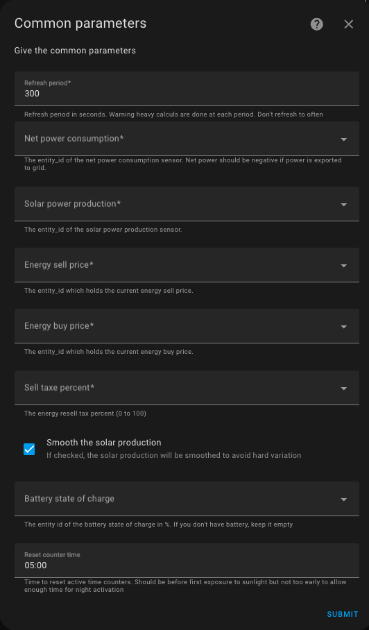
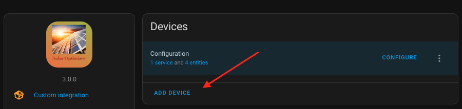
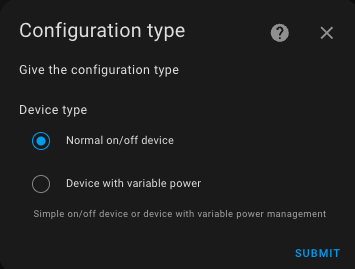
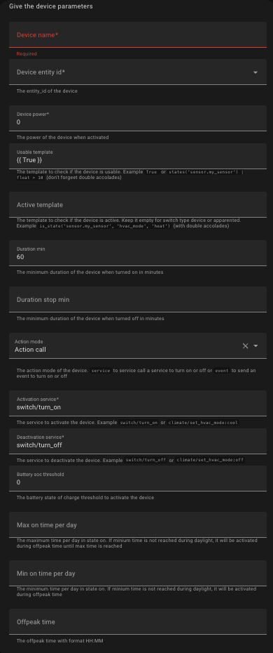

[![GitHub Release][releases-shield]][releases]
[![GitHub Activity][commits-shield]][commits]
[![License][license-shield]](LICENSE)
[![hacs][hacs_badge]][hacs]
[![BuyMeCoffee][buymecoffeebadge]][buymecoffee]

>  Cette intégration permet d'optimiser l'utilisation de votre énergie solaire. Elle commande l'allumage et l'extinction de vos équipements dont l'activation est différable dans le temps en fonction de la production et de la consommation électrique courante.

- [Qu'est-ce que Solar Optimizer ?](#quest-ce-que-solar-optimizer-)
- [Comment fonctionne-t-elle ?](#comment-fonctionne-t-elle-)
  - [Anti-bagot](#anti-bagot)
  - [Utilisabilité](#utilisabilité)
  - [Priorisation des équipements](#priorisation-des-équipements)
  - [Respecter les changements manuels](#respecter-les-changements-manuels)
  - [Réglage des coûts d'achat et de revente](#réglage-des-coûts-dachat-et-de-revente)
- [Installation](#installation)
  - [Procédure de migration d'une version 2.x vers la 3.x](#procédure-de-migration-dune-version-2x-vers-la-3x)
  - [HACS installation (recommendé)](#hacs-installation-recommendé)
  - [Installation manuelle](#installation-manuelle)
- [La configuration](#la-configuration)
  - [Configurer l'intégration pour la première fois](#configurer-lintégration-pour-la-première-fois)
  - [Configurer les équipements](#configurer-les-équipements)
    - [Configurer un équipement simple (on/off)](#configurer-un-équipement-simple-onoff)
    - [Définir le template d'activation](#définir-le-template-dactivation)
  - [Configurer un équipement avec une puissance variable](#configurer-un-équipement-avec-une-puissance-variable)
    - [Forçage en heures creuses](#forçage-en-heures-creuses)
      - [Conditions de validité](#conditions-de-validité)
  - [Exemples de configurations](#exemples-de-configurations)
    - [Commande d'une recharge de Tesla](#commande-dune-recharge-de-tesla)
    - [Commande d'une climatisation](#commande-dune-climatisation)
    - [Commande du preset d'une climatisation](#commande-du-preset-dune-climatisation)
    - [Commande d'un chauffe-eau](#commande-dun-chauffe-eau)
    - [Commande d'un deshumidificateur](#commande-dun-deshumidificateur)
    - [Commande pour une lampe](#commande-pour-une-lampe)
    - [Commande pour une lampe dimmable](#commande-pour-une-lampe-dimmable)
  - [Configurer l'algorithme en mode avancé](#configurer-lalgorithme-en-mode-avancé)
- [Entités disponibles](#entités-disponibles)
  - [L'appareil "configuration"](#lappareil-configuration)
  - [Les appareils](#les-appareils)
- [La gestion de la priorité](#la-gestion-de-la-priorité)
  - [Le poids de la priorité](#le-poids-de-la-priorité)
  - [La priorité d'un équipement](#la-priorité-dun-équipement)
- [Les évènements](#les-évènements)
- [Les actions](#les-actions)
  - [reset\_on\_time](#reset_on_time)
  - [start\_device](#start_device)
  - [stop\_device](#stop_device)
  - [clear\_override](#clear_override)
- [Créer des modèles de capteur pour votre installation](#créer-des-modèles-de-capteur-pour-votre-installation)
- [Carte Lovelace officielle](#carte-lovelace-officielle)
  - [Informations globales](#informations-globales)
  - [Informations par équipement](#informations-par-équipement)
  - [Statuts des équipements](#statuts-des-équipements)
  - [Informations secondaires](#informations-secondaires)
  - [Barre d'historique d'activation](#barre-dhistorique-dactivation)
  - [Actions disponibles](#actions-disponibles)
  - [Utilisation de la carte officielle](#utilisation-de-la-carte-officielle)
- [Les contributions sont les bienvenues !](#les-contributions-sont-les-bienvenues)

>  _*Nouveautés*_
> * **release 3.9.1** :
>   - **Consigne `offpeak_power` imposée pendant le forçage heures creuses** (issue [#231](https://github.com/jmcollin78/solar_optimizer/issues/231)) : lorsque le forçage heures creuses est actif sur un équipement à puissance variable, la consigne `offpeak_power` est désormais appliquée **quel que soit l'état demandé par l'algorithme**. Précédemment (issue #186), la valeur de l'algorithme prévalait dès que sa solution était active ; cette priorité sur la valeur est remplacée. La décision on/off reste inchangée (forçage ou algorithme) ; les limites de durée et la temporisation `duration_power_min` continuent de primer sur le forçage. La valeur est résolue une fois par cycle (si `offpeak_power` est un template, elle peut évoluer d'un cycle à l'autre) et le système ne ré-émet plus la consigne quand la mesure de puissance est indisponible.
> * **release 3.9.0** :
>   - `offpeak_power` : consigne envoyée à un équipement à puissance variable lorsqu'il est forcé en heures creuses ; `power_max` est utilisée par défaut.
>   - `max_on_time_offpeak_min` : durée maximale pendant laquelle tout équipement peut être forcé en heures creuses ; elle ne remplace pas l'objectif de durée minimale quotidienne.
> * **release 3.8.1** :
>   - **Activation forcée minutée** : nouveau sélecteur de durée (1h, 4h, 12h, 24h) à côté du bouton START. Lorsqu'une durée est sélectionnée, l'équipement est allumé en mode MANUEL pour la durée choisie puis s'éteint automatiquement et rend la main à SO. Le timer est persisté entre les redémarrages de HA. Cf. [start\_device](#start_device) et [stop\_device](#stop_device)
> * **release 3.8.0** :
>   - **Clarification des statuts** : nouveau statut `MANUEL` (ambre) lorsqu'un équipement est physiquement actif mais la gestion SO est désactivée. La bordure gauche reflète désormais toujours l'état physique (vert = allumé, gris = éteint), indépendamment de l'état de contrôle SO. Cf. [Statuts des équipements](#statuts-des-équipements)
>   - **Informations secondaires** : nouvelle option `secondary_info` pour afficher des informations personnalisées par équipement via des templates. Cf. [Informations secondaires](#informations-secondaires)
>   - **Blocs fermés par défaut** : tous les blocs équipement sont fermés au premier chargement. L'état ouvert/fermé de chaque bloc est persisté dans le `localStorage` du navigateur.

# Qu'est-ce que Solar Optimizer ?
Cette intégration va vous permettre de maximiser l'utilisation de votre production solaire. Vous lui déléguez le contrôle de vos équipements dontl'activation peut être différée dans le temps (chauffe-eau, pompe de piscine, charge de véhicle électrique, lave-vaisselle, lave-linge, etc) et elle s'occupe de les lancer lorsque la puissance produite est suffisante.

Elle tente en permanence de minimiser l'import et l'export d'énergie en démarrant, stoppant, modifiant la puissance allouée à un équipement.

2 types d'équipements sont gérés :
1. les équipements commandés par un switch (un service d'une manière générale) qui ont une puissance consommée fixe et pré-déterminée,
2. les équipements dont la puissance de consommation est réglable (Tesla, Robotdyn). En réglant la puissance allouée à ces équipements, Solar Optimizer aligne la consommation sur la production au plus près.

L'idéal est d'avoir au moins un équipement dont la puissance est ajustable dans la liste des équipements gérés par Solar Optimizer.

# Comment fonctionne-t-elle ?
Le fonctionnement est le suivant :
1. à interval régulier (paramétrable), l'algorithme simule des modifications des états des équipements (allumé / éteint / puissance allouée) et calcule un coût de cette configuration. Globalement le coût est le `a * puissance_importée + b * puissance_exportée`. La coefficients a et b sont calculés en fonction du cout de l'électricité au moment du calcul,
2. l'algorithme garde la meilleure configuration (celle qui a un cout minimum) et cherche d'autres solutions, jusqu'à ce qu'un minimum soit atteint.
3. la meilleure configuration est alors appliquée.

L'algorithme utilisé est un algorithme de type recuit simulé dont vous trouverez une description ici : https://fr.wikipedia.org/wiki/Recuit_simul%C3%A9

## Anti-bagot
Pour éviter les effets de bagottements d'un cycle à l'autre, un délai minimal d'activation est paramétrable par équipements : `duration_min`. Par exemple : un chauffe-eau doit être activé au moins une heure pour que l'allumage soit utile, la charge d'une voiture électrique doit durer au moins deux heures, ...
De façon similaire, une durée minimale de désactivation peut être spécifiée dans le paramètre `duration_stop_min`.

## Utilisabilité
A chaque équipement configuré est associé une entité de type switch nommé `enable` qui permet d'autoriser l'algorithme à utiliser l'équipement. Si je veux forcer la chauffe du ballon d'eau chauffe, je mets son switch sur off. L'algorithme ne le regardera donc pas, le chauffe-eau repasse en manuel, non géré par Solar Optimizer.

Par ailleurs, il est possible de définir une règle d'utilisabilité des équipements. Par exemple, si la voiture est chargée à plus de 90%, l'algorithme considère que l'équipement qui pilote la charge de la voiture doit être éteint. Cette régle est définit sous la forme d'un template configurable qui vaut True si l'équipement est utilisable.

Si une batterie est spécifiée lors du paramétrage de l'intégration et si le seuil `battery_soc_threshold` est spécifié, l'équipement ne sera utilisable que si le soc (pourcentage de charge de la batterie) est supérieur ou égal au seuil.

Un temps d'utilisation maximal journalier est paramétrable en facultatif. Si il est valorisé et si la durée d'utilisation de l'équipement est dépasée, alors l'équipement ne sera pas utilisable par l'algorithme et laisse donc de la puissance pour les autres équipements.

Un temps d'utilisation minimal journalier est aussi paramétrable en facultatif. Ce paramètre permet d'assurer que l'équipement sera allumé pendant une certaine durée minimale. Vous spécifiez à quelle heure commence les heures creuses, (`offpeak_time`) et la durée minimale en minutes (`min_on_time_per_day_min`). Si à l'heure indiquée par `offpeak_time`, la durée minimale d'activation n'a pas été atteinte, alors l'équipement est activé jusqu'au changement de jour (paramètrable dans l'intégration et 05:00 par défaut) ou jusqu'à ce que le maximum d'utilisation soit atteint (`max_on_time_per_day_min`) ou pendant toute la durée des heures creuses si `max_on_time_per_day_min` n'est pas précisé. Vous assurez ainsi que le chauffe-eau ou la voiture sera chargée le lendemain matin même si la production solaire n'a pas permise de recharger l'appareil. A vous d'inventer les usages de cette fonction.

Ces 5 règles permettent à l'algorithme de ne commander que ce qui est réellement utile à un instant t. Ces règles sont ré-évaluées à chaque cycle.

## Priorisation des équipements
La gestion de la priorité est décrite [ici](#la-gestion-de-la-priorité).

## Respecter les changements manuels
Par défaut, Solar Optimizer pilote les équipements qu'il gère : si un équipement est allumé ou éteint en dehors de lui (à la main, depuis un autre tableau de bord, un assistant vocal, une autre automatisation...), Solar Optimizer le remet dans l'état qu'il a décidé au cycle suivant. Par exemple, un VE qui démarre sa charge quand on le branche est arrêté tant que les conditions ne sont pas réunies. Pour forcer un équipement, utilisez les boutons START/STOP de la [carte](#carte-lovelace-officielle).

Chaque équipement a un switch **Respecter les changements manuels** (`switch.respect_manual_changes_solar_optimizer_<name>`) pour changer ce comportement, pour cet équipement uniquement :
- **Désactivé (par défaut)** : rien ne change, Solar Optimizer se comporte exactement comme dans les versions précédentes.
- **Activé** : un changement manuel de l'équipement est respecté. Par exemple, quelqu'un allume la pompe de la piscine depuis son propre interrupteur pour aller se baigner : Solar Optimizer la laisse allumée au lieu de l'éteindre au cycle suivant. L'équipement est mis en pause (une *reprise en main manuelle*, indiquée par `binary_sensor.solar_optimizer_override_<name>`) jusqu'à ce qu'il revienne à l'état voulu par Solar Optimizer, l'heure de remise à zéro (`raz_time`), la réactivation du switch Enable, l'appel de l'action [clear\_override](#clear_override), ou la désactivation de ce switch.
- Allumer ou éteindre `switch.solar_optimizer_<name>` (le switch **Active**) est par défaut une simple commande, que l'algorithme peut annuler à sa prochaine décision. Cochez **Considérer l'action sur le switch Active comme une reprise en main** dans la configuration de l'équipement pour la respecter aussi comme une reprise en main manuelle.

Le switch conserve son état après un redémarrage. Pour l'activer, ouvrez la page de l'équipement (**Paramètres > Appareils et services > Solar Optimizer**, puis l'équipement), ou affichez-le dans la carte (cf. [Utilisation de la carte officielle](#utilisation-de-la-carte-officielle)).

## Réglage des coûts d'achat et de revente
Le comportement de l'algorithme est fortement influencé par les valeurs des capteurs "coût du kWh importé" et "coût du kWh exporté". En effet, l'algorithme va calculer le "coût fictif" d'une combinaison d'allumage / extinction / puissance voulue des équipemenets pilotés.
Si ces 2 valeurs sont égales alors le coût d'un import du réseau de 500 w sera le même que le coût d'un export vers le réseau de 500 w. Donc SO pourra soit rejeter les 500 w (sous-consommation), soit importer 500w (sur-consommation), si la puissance produite le permet.

Les valeurs des sensors de couts de revente et d'achat doivent être réglées comme suit:

1. si elles sont égales, SO acceptera autant d'import que d'export. Ca "coute" la même chose pour lui d'exporter 500 w que d'importer 500 w,
2. si cout d'achat est très supérieur à cout de revente, SO va minimiser l'achat mais va potentiellement exporter plus (énergie perdue),
3. si cout de revente >> cout d'achat, c'est le contraire, SO va minimiser la revente et donc potentiellement importer plus (et donc la facture augmente)

👉 Si vous ne voulez aucun import (ie achat) : dans ce cas vous devez mettre un coût d'achat >> cout de revente,
👉 Pour ceux qui ont des contrats d'auto-consommation sans revente, tout ce qui est rejetté est perdu donc vous pouvez avoir intérêt à minimiser les rejets quitte à acheter un plus plus. Pour cette configuration, le coût de revente >> coût d'achat.

De mon coté j'ai mis les vraies valeurs de cout d'achat (qui varie selon le jour, l'heure : abonnement Tempo) et le vrai cout de revente qui est de 13cts le kWh. Donc si mon cout d'achat devient faible (heure creuse en bleu), je peux importer plus, si le cout d'achat est très fort (heure pleines rouge), je n'aurai pas d'import du tout. C'est bien ce que je veux dans mon cas - mais ce n'est que mon cas et parce-que j'ai un contrat de revente à 13 cts/kWh.

**⚠️ ATTENTION** : les coûts ne doivent pas être nuls !

# Installation

## Procédure de migration d'une version 2.x vers la 3.x
La version 3.0.0 amène une IHM de configuration qui permet d'ajouter facilement des nouveaux équipements à contrôler et de changer facilement leur configuration.

Cette procédure, ne doit être déroulée que si vous avez déjà installée et configurée une version 2.x.

L'installation de la v 3.0.0 impose de recréer tous les équipements via l'IHM et de supprimer la configuration du fichier `configuration.yaml`. La procédure à suivre est la suivante, elle doit être suivie scrupuleusement :
1. allez dans Paramètres / Intégration, sélectionnez "Solar Optimizer" et supprimez l'appareil "Solar Optimizer". L'intégration "Solar Optimizer" ne doit plus être visible,
2. supprimez la configuration qui est dans votre fichier `configuration.yaml`,
3. lancez HACS, recherchez "Solar Optimizer" et faite l'installation de la version 3.0.0,
4. Allez dans Paramètres / Intégration et cliquez sur "Ajouter une intégration" et sélectionnez "Solar optimizer",
5. Vous arrivez sur la page de configuration des paramètres communs décrites [ici](#configurer-lintégration-pour-la-première-fois)

## HACS installation (recommendé)

1. Installez [HACS](https://hacs.xyz/). De cette façon, vous obtenez automatiquement les mises à jour.
2. Ajoutez ce repository Github en tant que repository personnalisé dans les paramètres HACS.
3. recherchez et installez "Solar Optimizer" dans HACS et cliquez sur "installer".
4. Redémarrez Home Assistant.
5. Ensuite, vous pouvez ajouter l'intégration de Solar Optimizer dans la page d'intégration. Vous ne pouvez installer qu'une seule intégration Solar Optimizer.

## Installation manuelle
Une installation manuelle est possible. Elle n'est pas recommandée et donc elle ne sera pas décrite ici.

# La configuration
## Configurer l'intégration pour la première fois
Lors de l'ajout de l'intégration Solar Optimizer, la page de paramétrage des paramètres communs s'ouvre :

Vous devez spécifier :
1. **une période de rafraichissement** en secondes. Plus la période est courte et plus le suivi sera précis mais plus la charge du votre serveur sera importante ; les calculs sont en effet gourmands en charge CPU. 5 minutes (donc 300 sec) est une bonne valeur moyenne,
2. le sensor qui donne **la consommation nette instantanée** du logement (elle doit être négative si la production dépasse la consommation). Ce chiffre est indiqué en Watt,
3. le sensor qui donne **la production photovoltaïque instantanée** en Watt aussi (elle est forcément positive ou nulle),
4. un sensor ou input_number qui donne **le cout du kwh importé** (requis: nombre strictement positif),
5. un sensor ou input_number qui donne **le prix du kwh exporté** (requis: nombre strictement positif). On peut utiliser la même valeur/sensor que l'importée si pas de contrat de revente. Ne pas mettre 0 sinon ça fausse trop l'algorithme,
6. un sensor ou input_number qui donne **la valeur de la taxe applicable sur les kwh exportée** en pourcentage (chiffre positif ou 0 si vous ne revendez pas ou ne connaissez pas cette valeur). Cette valeur dépend de votre contrat. Elle n'est pas déterminante dans l'algorithme donc une valeur de 0 est tout à fait adaptée,
7. un sensor facultatif qui donne **l'état de charge d'une éventuelle batterie solaire** en pourcentage. Si vous n'avez pas de batterie dans votre installation solaire, laissez ce champ vide,
8. un sensor qui donne la **puissance nette instantanée de charge de la batterie**. Elle doit être exprimée en watt et doit être négative si la batterie charge et positive si la batterie se décharge. Cette valeur sera ajoutée à la puissance net consommée. Si la puissance consommée nette est de -1000 w (vente de 1000 w) mais que la batterie charge de -500 w, cela veut dire que le surplus utilisable par l'algorithme est de 1500 w.
9. **l'heure de début de journée**. A cette heure les compteurs d'uitlisation des équipements sont remis à zéro. La valeur par défaut est 05:00. Pour bien faire, elle doit être avant la première production et le plus tard possible pour les activations en heures creuses.

A part l'état de charge de la batterie solaire, ces informations sont nécessaires à l'algorithme pour fonctionner, elles sont donc toutes obligatoires. Le fait que ce soit des sensor ou input_number permet d'avoir des valeurs qui sont réévaluées à chaque cycle. En conséquence le passage en heure creuse peut modifier le calcul et donc les états des équipements puisque l'import devient moins cher. Donc tout est dynamique et recalculé à chaque cycle.

## Configurer les équipements
Chaque équipements pilotable doit ensuite être configuré en ajoutant une nouvelle intégration via la bouton "Ajouter un équipement" disponible dans la page de l'intégration :

Le menu suivant s'affiche alors vous permettant de choisir un équipement simple qui va fonctionner en on/off ou un équipement dont la puissance est variable (pour suivre la puissance disponible) :

### Configurer un équipement simple (on/off)
Un équipement simple est un commande uniquement par un allumage / extinction (un switch). Si l'algorithme décide de l'allumer, l'équipement est allumé et sinon il est éteint. Il se configure de la façon suivante :

Vous devez spécifier les attributs suivant :

| attribut                      | valable pour                            | signification                                                                                                                                                                                                                                | exemple                                               | commentaire                                                                                                                                                                                                                                         |
| ----------------------------- | --------------------------------------- | -------------------------------------------------------------------------------------------------------------------------------------------------------------------------------------------------------------------------------------------- | ----------------------------------------------------- | --------------------------------------------------------------------------------------------------------------------------------------------------------------------------------------------------------------------------------------------------- |
| `name`                        | tous                                    | Le nom de l'équipement.                                                                                                                                                                                                                      | VMC sous-sol                                          | Le nom est utilisé pour nommé les entités de cet équipement.                                                                                                                                                                                        |
| `entity_id`                   | tous                                    | l'entity id de l'équipement à commander                                                                                                                                                                                                      | switch.vmc_sous_sol                                   | Peut être un `switch`, un `input_boolean`, un `humidifier`, un `climate`, un `fan`, un `select`, un `light` ou un `water_heater`. Si l'entité n'est pas un `switch`, les champs `activation_service` et `deactivation_service` doivent être adaptés |
| `device_power` or `power_max` | tous                                    | la puissance maximale consommée par l'équipement lorsqu'il est allumé en watts                                                                                                                                                               | 250                                                   | -                                                                                                                                                                                                                                                   |
| `check_usable_template`       | tous                                    | Un template qui vaut True si l'équipement pourra être utilisé par Solar Optimizer. Un template commence par {{ et doit se terminer par }}.                                                                                                   | {{ is_state('cover.porte_garage_garage', 'closed') }} | Dans l'exemple, Sonar Optimizer n'essayera pas de commander la "VMC sous-sol" si la porte du garage est ouverte. Laissez {{ True }} si vous ne vous servez pas de ce champ                                                                          |
| `active_template`             | tous                                    | Un template qui vaut True si l'équipement si l'équipement est actif. Un template commence par {{ et doit se terminer par }}. Ce template n'est pas nécessaire si l'état allumé est 'on' (switch, light, humidifier)                          | {{ is_state('climate.clim_salon', 'cool') }}          | Dans l'exemple, l'équipement de type `climate` sera vu par Solar Optimizer comme actif si son état est `cool`. Laissez vide pour les équipements pour lesquels l'état par défaut 'on' / 'off' est valable (les switchs et input_boolean)            |
| `duration_min`                | tous                                    | La durée en minute minimale d'activation                                                                                                                                                                                                     | 60                                                    | La VMC sous-sol s'allumera toujours pour une heure au minimum                                                                                                                                                                                       |
| `duration_stop_min`           | tous                                    | La durée en minute minimale de desactivation. Vaut `duration_min` si elle n'est pas précisée                                                                                                                                                 | 15                                                    | La VMC sous-sol s'éteindra toujours pour 15 min au minimum                                                                                                                                                                                          |
| `action_mode`                 | tous                                    | le mode d'action pour allumer ou éteindre l'équipement. Peut être "action_call" ou "event" (*)                                                                                                                                               | action_call                                           | "action_call" indique que l'équipement s'allume et s'éteint via une action. Cf. ci-dessous. "event" indique qu'un évènement est envoyé lorsque l'état doit changer. Cf. (*)                                                                         |
| `activation_service`          | uniquement si action_mode="action_call" | le service a appeler pour activer l'équipement sous la forme "domain/service[/parameter:value]". Ce template doit être adapté pour tous les équipements qui ne sont pas des switchs                                                          | switch/turn_on                                        | l'activation déclenchera le service "switch/turn_on" sur l'entité "entity_id". La syntaxe acceptée est la suivante : domain/action[/parameter:value]                                                                                                |
| `deactivation_service`        | uniquement si action_mode="action_call" | le service a appeler pour désactiver l'équipement sous la forme "domain/service[/parameter:value]". Ce template doit être adapté pour tous les devices qui ne sont pas des switchs                                                           | switch/turn_off                                       | la désactivation déclenchera le service "switch/turn_off" sur l'entité "entity_id". La syntaxe acceptée est la suivante : domain/action[/parameter:value]                                                                                           |
| `battery_soc_threshold`       | tous                                    | le pourcentage minimal de charge de la batterie pour que l'équipement soit utilisable                                                                                                                                                        | 30                                                    | Dans cet exemple, l'équipement ne sera utilisable par l'algorithme si la batterie solaire n'est pas chargée à au moins 30%. Nécessite le renseignement de l'entité d'état de charge de la batterie dans les paramètres communs. Cf. ci-dessus.      |
| `max_on_time_per_day_min`     | tous                                    | le nombre de minutes maximal en position allumé pour cet équipement. Au delà, l'équipement n'est plus utilisable par l'algorithme                                                                                                            | 10                                                    | L'équipement sera allumé au maximum 10 minutes par jour                                                                                                                                                                                             |
| `min_on_time_per_day_min`     | tous                                    | le nombre de minutes minimale en position allumé pour cet équipement. Si lors du démarrage des heures creuses, ce minimum n'est pas atteint alors l'équipement sera allumé à concurrence du début de journée ou du `max_on_time_per_day_min` | 5                                                     | L'équipement est sera allumé au minimum 5 minutes par jour ; soit pendant la production solaire, soit pendant les heures creuses                                                                                                                    |
| `measured_power_entity_id`    | tous (optionnel)                        | Un capteur qui mesure la puissance réellement consommée par l'équipement, en W ou kW (ex : prise connectée)                                                                                                                                  | sensor.lave_linge_puissance                           | Affichage seulement : la carte montre la puissance mesurée dans la barre et le graphique de puissance, avec la puissance configurée en pointillés. L'algorithme continue d'utiliser `power_max` comme budget.                                       |
| `active_switch_is_override`   | tous (optionnel, décoché par défaut)    | Seulement si le switch **Respecter les changements manuels** est activé : allumer ou éteindre `switch.solar_optimizer_<name>` est respecté comme une reprise en main manuelle.                                                               | coché                                                 | Décoché : le switch Active est une simple commande que l'algorithme peut annuler. Un changement fait sur l'équipement lui-même est toujours respecté.                                                                                               |
| `offpeak_time`                | tous                                    | L'heure de début des heures creuses au format hh:mm                                                                                                                                                                                          | 22:00                                                 | L'équipement pourra être allumé à 22h00 si la production de la journée n'a pas été suffisante                                                                                                                                                       |

### Définir le template d'activation

Le champ `check_active_template` indique à Solar Optimizer si l'équipement est effectivement actif. Laissez-le vide lorsque l'état `on` / `off` de l'entité représente directement son activité. Sinon, renseignez un template qui retourne `True` pour le mode actif configuré.

| Domaine                                                 | Valeur recommandée pour `check_active_template`                                                                                                                     |
| ------------------------------------------------------- | ------------------------------------------------------------------------------------------------------------------------------------------------------------------- |
| `switch`, `input_boolean`, `light`, `humidifier`, `fan` | Laisser vide si l'état `on` signifie que l'équipement est actif.                                                                                                    |
| `climate` avec un mode HVAC                             | `{{ is_state('climate.mon_appareil', 'heat') }}` ou le mode choisi, par exemple `cool`.                                                                             |
| `climate` avec un preset                                | `{{ is_state_attr('climate.mon_appareil', 'preset_mode', 'boost') }}` ou le preset choisi.                                                                          |
| `water_heater`                                          | `{{ is_state('water_heater.mon_chauffe_eau', 'high_demand') }}` ou le mode d'activation choisi. Les modes disponibles dépendent de l'intégration.                   |
| `select`                                                | `{{ is_state('select.mon_appareil', 'option_active') }}` avec l'option sélectionnée comme état actif.                                                               |
| `button`                                                | Utiliser l'entité qui reflète l'activité réelle, par exemple `{{ is_state('binary_sensor.mon_appareil_actif', 'on') }}`. Un bouton n'a pas d'état actif persistant. |

## Configurer un équipement avec une puissance variable
Ce type d'équipement permet moduler la puissance consommée par l'équipement en fonction de la production solaire et de ce que décide l'algorithme. Vous avez ainsi une sorte de routeur solaire logiciel qui permet, par exemple, de moduler la charge d'une voiture électrique avec uniquement le surplus de production.

### Forçage en heures creuses

- **`max_on_time_offpeak_min`** — Disponible pour tous les équipements. Cette durée optionnelle, exprimée en minutes, limite le temps de fonctionnement **forcé** pendant les heures creuses lorsque la durée minimale quotidienne n'est pas encore atteinte. Elle peut être un nombre ou un template ; si elle est vide, Solar Optimizer utilise `max_on_time_per_day_min`. Elle ne remplace pas `min_on_time_per_day_min`, qui reste l'objectif à atteindre : elle constitue uniquement une limite de sécurité. Sa valeur doit être positive ou nulle, ne pas dépasser le maximum quotidien et ne pas être inférieure à la durée minimale quotidienne lorsque celle-ci est positive.
- **`offpeak_power`** — Disponible uniquement pour les équipements à puissance variable. Cette consigne, sous forme de nombre ou de template, est envoyée explicitement lorsque Solar Optimizer force l'activation pendant les heures creuses. Elle est notamment utile lorsque l'équipement remet sa puissance à zéro après une extinction. Si elle est vide, Solar Optimizer envoie `power_max`. Sa valeur doit être strictement positive, comprise entre `power_min` et `power_max`, et alignée sur `power_step`. Les équipements on/off n'exposent ni n'utilisent ce réglage.

Lorsque le forçage heures creuses est actif, cette consigne est appliquée **quel que soit l'état demandé par l'algorithme** : l'algorithme peut toujours décider de l'allumage ou de l'extinction de l'équipement, mais la valeur de puissance réellement envoyée est toujours la consigne heures creuses (issue #231, qui remplace la priorité de la valeur de l'algorithme introduite par l'issue #186). Tant que le forçage est actif, la décision « non applicable » (appareil inactif, temporisation `duration_power_min` en cours, limite de durée atteinte) est journalisée en niveau `debug` avec son motif.
