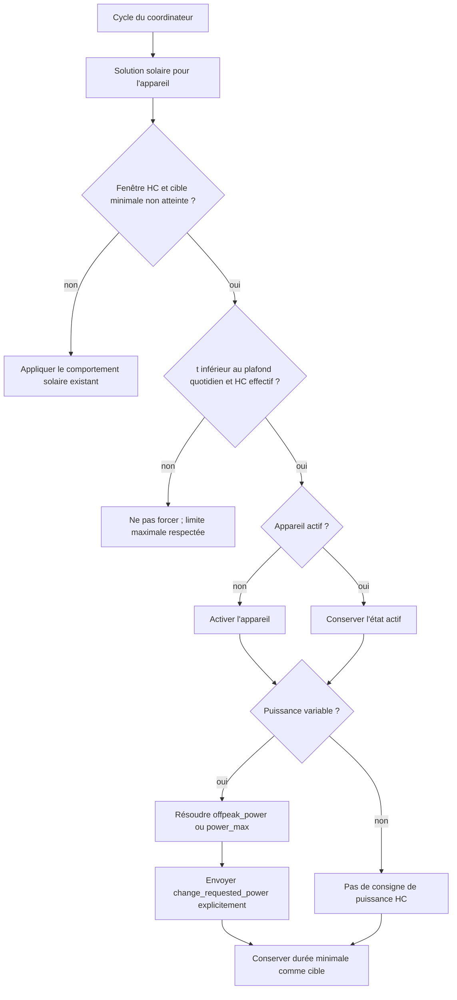

# Conception technique détaillée - Issue #186 - Puissance et durée spécifiques aux heures creuses

## 1. Métadonnées et sources

| Champ                        | Valeur                                                                                   |
| ---------------------------- | ---------------------------------------------------------------------------------------- |
| Statut                       | Prêt pour implémentation, sous réserve des décisions signalées en section 11             |
| Version du document          | 1.0                                                                                      |
| Date                         | 2026-10-10                                                                               |
| Propriétaire                 | Projet Solar Optimizer                                                                   |
| Périmètre                    | Configuration, exécution HC, validation, tests, documentation et release de l'issue #186 |
| Version intégration vérifiée | `3.8.4`                                                                                  |

### Sources analysées

- [Rapport validé](issue-186-review.md)
- [Spécification fonctionnelle validée](issue-186-specifications.md)
- [Implémentation des appareils gérés](../../custom_components/solar_optimizer/managed_device.py)
- [Boucle d'application de la solution](../../custom_components/solar_optimizer/coordinator.py)
- [Schémas et flux de configuration](../../custom_components/solar_optimizer/config_schema.py) et [config_flow.py](../../custom_components/solar_optimizer/config_flow.py)
- [Constantes](../../custom_components/solar_optimizer/const.py), [manifest](../../custom_components/solar_optimizer/manifest.json) et traductions existantes
- Tests [test_min_on_time.py](../../tests/test_min_on_time.py), [test_power_device.py](../../tests/test_power_device.py), [test_config_flow.py](../../tests/test_config_flow.py) et [test_templating.py](../../tests/test_templating.py)
- [README anglais](../../README.md) et [README français](../../README-fr.md)

Les états et chemins qualifiés de « vérifiés » correspondent au dépôt dans sa version analysée. Les clés, méthodes et règles marquées « proposés » sont des décisions de conception pour une future implémentation ; ils ne sont pas disponibles aujourd'hui.

## 2. Objectif, périmètre et traçabilité

L'évolution permet, pendant une activation déclenchée par les heures creuses (HC), de transmettre une consigne de puissance explicite à un appareil à puissance variable et d'appliquer une durée maximale propre aux HC à tous les appareils.

Le périmètre couvre exactement les exigences suivantes :

| Exigences                        | Décision de conception                                                                                                                                                                                         |
| -------------------------------- | -------------------------------------------------------------------------------------------------------------------------------------------------------------------------------------------------------------- |
| FR-001 à FR-003, AC-001 à AC-003 | `offpeak_power` est exposé uniquement dans le formulaire d'appareil à puissance variable. Une activation HC transmet cette valeur, ou `power_max` en repli. Aucun appareil standard ne reçoit une consigne HC. |
| FR-004 à FR-007, AC-004 à AC-007 | `max_on_time_offpeak_min` est exposé dans les deux formulaires. Il limite le forçage HC sans devenir la cible : `min_on_time_per_day_min` reste la cible.                                                      |
| FR-008 à FR-009, AC-008 à AC-009 | Les options absentes utilisent les replis prescrits ; les valeurs présentes mais invalides sont refusées explicitement.                                                                                        |
| FR-010 à FR-011, AC-010 à AC-012 | Les tests, les deux README, les traductions et une hausse mineure de version font partie de la livraison.                                                                                                      |

Sont exclus : puissance HC pour appareil standard, modification de l'algorithme de recuit, modification de la durée minimale, gestion de stockage ou nouvelle reprise après refus de service par l'appareil.

## 3. État existant vérifié

### 3.1 Configuration et représentation

- `managed_device_schema` et `power_managed_device_schema` partagent `max_on_time_per_day_min`, `min_on_time_per_day_min` et `offpeak_time`. Seul le second distingue un appareil à puissance variable par `power_min >= 0` et `can_change_power`.
- Les valeurs `power_max`, `max_on_time_per_day_min` et `min_on_time_per_day_min` acceptent déjà nombres ou templates, via `convert_to_template_or_value` puis `get_template_or_value`.
- En l'absence de `max_on_time_per_day_min`, `ManagedDevice` utilise actuellement `24 * 60` minutes. En l'absence de durée minimale, la valeur effective est `0`.
- `ManagedDevice` rejette déjà une durée minimale positive sans `offpeak_time` et une durée minimale supérieure au plafond quotidien effectif.

### 3.2 Exécution HC et défaut à corriger

1. Le coordinateur calcule la solution solaire, puis appelle `device.should_be_forced_offpeak` pour chaque appareil.
2. `should_be_forced_offpeak` vérifie actuellement la fenêtre HC, l'utilisabilité, le plafond quotidien et le fait que le temps de marche cumulé est inférieur à la durée minimale.
3. Le coordinateur appelle `activate(requested_power)` si l'appareil est inactif et que l'algorithme ou les HC demandent une activation.
4. Il n'appelle `change_requested_power(requested_power)` que si l'état de la solution algorithmique est actif.

Lors d'un forçage HC avec une solution solaire inactive, `state` est donc faux : l'appareil variable est activé mais la seconde commande de puissance n'est pas envoyée. C'est le défaut confirmé par le rapport.

### 3.3 Invariants à préserver

- Les délais anti-battement `duration_min`, `duration_stop_min` et `duration_power_min` restent appliqués par `ManagedDevice`.
- La durée cumulée quotidienne (`_on_time_sec`) reste la référence pour la cible minimale, le plafond quotidien et le plafond HC ; aucun nouveau compteur n'est créé.
- Les activations forcées manuelles avec `start_forced()` et leur minuteur sont indépendantes des HC et ne changent pas.
- Les entités, services et événements existants restent inchangés. La nouvelle puissance est envoyée par le service de changement de puissance déjà configuré.

## 4. Solution retenue

### 4.1 Nouvelles clés de configuration proposées

| Constante proposée             | Clé persistée             | Types autorisés                                   | Portée                                    | Absence et valeur effective        |
| ------------------------------ | ------------------------- | ------------------------------------------------- | ----------------------------------------- | ---------------------------------- |
| `CONF_OFFPEAK_POWER`           | `offpeak_power`           | nombre ou template numérique existant             | appareils à puissance variable uniquement | `power_max`                        |
| `CONF_MAX_ON_TIME_OFFPEAK_MIN` | `max_on_time_offpeak_min` | nombre ou template numérique existant, en minutes | tous les appareils gérés                  | `max_on_time_per_day_min` effectif |

Les deux clés restent optionnelles et ne reçoivent pas de valeur écrite implicitement dans la `ConfigEntry`. La présence de `None`/absence est ainsi distinguée d'une valeur explicite, notamment `0` pour une durée. Les propriétés de `ManagedDevice` calculent les valeurs effectives à la lecture.

`offpeak_power` est placé seulement dans `power_managed_device_schema`. `max_on_time_offpeak_min` est placé dans les deux schémas, à côté des limites quotidiennes existantes. Les libellés et descriptions sont ajoutés aux traductions FR et EN pour les étapes `device` et `powered_device` concernées.

### 4.2 Responsabilités des composants

| Composant                                      | Responsabilité après évolution                                                                                                                                 |
| ---------------------------------------------- | -------------------------------------------------------------------------------------------------------------------------------------------------------------- |
| `const.py`                                     | Déclarer les deux constantes de configuration.                                                                                                                 |
| `config_schema.py`                             | Exposer les champs dans les seuls formulaires autorisés et appliquer la validation statique de forme.                                                          |
| `config_flow.py`                               | Valider la cohérence inter-champs avant création ou mise à jour de l'entrée ; ne pas persister une valeur invalide.                                            |
| `managed_device.py`                            | Convertir les valeurs optionnelles, exposer leurs valeurs effectives, valider les valeurs résolues et décider si le forçage HC est encore autorisé.            |
| `coordinator.py`                               | Distinguer la puissance demandée par l'algorithme de la puissance imposée par HC, puis envoyer explicitement cette dernière seulement aux appareils variables. |
| `translations/fr.json`, `translations/en.json` | Rendre les options et erreurs compréhensibles dans les deux langues.                                                                                           |

## 5. Modèle de données, validation et compatibilité

### 5.1 Valeurs effectives

Pour un appareil $d$, avec $t$ le temps de marche quotidien cumulé :

$$
P_{HC}(d) =
\begin{cases}
offpeak\_power(d) & \text{si l'appareil est variable et la valeur est présente} \\
power\_max(d) & \text{si l'appareil est variable et la valeur est absente}
\end{cases}
$$

$$
M_{HC}(d) =
\begin{cases}
max\_on\_time\_offpeak\_min(d) & \text{si la valeur est présente} \\
max\_on\_time\_per\_day\_min(d) & \text{si la valeur est absente}
\end{cases}
$$

Le plafond réellement applicable durant HC est :

$$M_{effectif}(d) = \min(M_{jour}(d), M_{HC}(d))$$

Cette règle préserve le plafond quotidien comme garde-fou absolu. Lorsque la valeur HC est absente, $M_{HC} = M_{jour}$ : le résultat est donc exactement le plafond quotidien effectif, y compris son repli historique à 1 440 minutes si `max_on_time_per_day_min` est absent.

La condition de forçage devient : fenêtre HC active, appareil utilisable hors limites de durée, $t < min\_on\_time\_per\_day\_min$, et $t < M_{effectif}$. La durée minimale demeure la cible. Si le plafond HC est atteint avant elle, l'arrêt est obligatoire : la cible ne doit pas être dépassée pour la satisfaire.

### 5.2 Règles de validation retenues

La validation est bloquante : le formulaire retourne une erreur localisée et l'entrée n'est ni créée ni mise à jour. Une valeur issue d'un template ne peut pas toujours être vérifiée définitivement à l'enregistrement ; elle fait donc aussi l'objet d'une validation de sûreté à sa résolution avant toute commande. Une erreur résolue au runtime rend l'appareil non exploitable pour le cycle concerné, est journalisée clairement et ne déclenche aucun service avec la valeur invalide.

| Valeur                                | Validation statique ou à résolution                                                                                             | Règle retenue                                                                                                      |
| ------------------------------------- | ------------------------------------------------------------------------------------------------------------------------------- | ------------------------------------------------------------------------------------------------------------------ |
| `offpeak_power` absente               | Acceptée                                                                                                                        | Repli vers `power_max`, sans écriture de valeur.                                                                   |
| `offpeak_power` présente              | Numérique, finie et strictement positive ; $power\_min \le P_{HC} \le power\_max$ ; alignée sur `power_step` depuis `power_min` | Rejet sinon. L'alignement garantit que la valeur est une consigne déjà représentable par l'appareil.               |
| `offpeak_power` sur appareil standard | Impossible dans l'interface ; rejet explicite si injectée dans une `ConfigEntry`                                                | Ne jamais la lire ni l'envoyer comme consigne HC.                                                                  |
| `max_on_time_offpeak_min` absente     | Acceptée                                                                                                                        | Repli vers la valeur quotidienne effective.                                                                        |
| `max_on_time_offpeak_min` présente    | Numérique, finie, entière ou décimale non négative, en minutes ; $M_{HC} \le M_{jour}$                                          | Rejet sinon. `0` est permis seulement lorsque la durée minimale est aussi `0`; il désactive de fait le forçage HC. |
| Toutes les durées                     | $min\_on\_time\_per\_day\_min \le M_{HC}$ lorsque la durée minimale est positive                                                | Rejet sinon, car la cible minimale serait structurellement impossible à atteindre durant HC.                       |

Les comparaisons sont effectuées sur les valeurs effectives résolues, en minutes pour les durées et dans l'unité de puissance déjà utilisée par l'appareil. La contrainte $M_{HC} \le M_{jour}$ rend explicite le fait vérifié que la limite quotidienne ne doit jamais être élargie par HC. Pour conserver l'usage de templates existant, une valeur template est admise au schéma, mais tout rendu non numérique, négatif, non fini ou incohérent produit la même erreur explicite au démarrage ou au cycle concerné.

### 5.3 Compatibilité ascendante et migration

- Aucune migration de données n'est nécessaire : l'absence des nouvelles clés est le contrat de repli.
- Un appareil variable existant reçoit désormais explicitement `power_max` lors du forçage HC. C'est le changement fonctionnel requis et le repli imposé, pas une rupture de configuration.
- Un appareil, variable ou non, sans durée HC conserve comme plafond HC son plafond quotidien effectif. Si le plafond quotidien était absent, le repli existant de 1 440 minutes est conservé indirectement.
- Un appareil standard existant ne reçoit pas de service de changement de puissance.
- Une incrémentation de `CONFIG_MINOR_VERSION` n'est pas requise pour l'absence d'options et ne doit être envisagée que si l'implémentation change le format d'une entrée existante. La version de distribution du manifeste doit, elle, recevoir une hausse mineure conformément à FR-011.

## 6. Flux d'exécution proposé



### 6.1 Pseudocode de décision

```text
max_daily = device.max_on_time_per_day_sec
max_offpeak = device.max_on_time_offpeak_sec  # valeur HC ou repli max_daily
offpeak_limit = min(max_daily, max_offpeak)

can_force_offpeak = (
    offpeak_window_is_open
    and device.check_usable_except_duration_limits()
    and on_time_sec < min_on_time_per_day_sec
    and on_time_sec < offpeak_limit
)

if algorithm_state is false and can_force_offpeak is false:
    deactivate_if_current_behavior_requires_it()
elif device is inactive and (algorithm_state or can_force_offpeak):
    activate(algorithm_requested_power if algorithm_state else offpeak_requested_power)

if device.can_change_power and (algorithm_state or can_force_offpeak):
    requested_power = algorithm_requested_power if algorithm_state else device.offpeak_power
    if device was inactive or device.current_power != requested_power:
        change_requested_power(requested_power)

device.set_requested_power(last_effective_requested_power)
```

L'implémentation doit isoler une vérification d'utilisabilité qui conserve le template, le délai de cycle et le seuil batterie, mais paramètre ou sépare la limite de durée. Réutiliser `check_usable(False)` sans adaptation est insuffisant : il bloque actuellement seulement sur `max_on_time_per_day_sec` avant que le nouveau plafond HC puisse être évalué. La valeur effective de puissance HC doit être sélectionnée une seule fois par cycle et réutilisée pour `activate` puis `change_requested_power`, afin d'éviter une divergence si un template varie entre deux rendus.

### 6.2 Séquences et cas limites

| Situation                                 | Comportement attendu                                                                                             |
| ----------------------------------------- | ---------------------------------------------------------------------------------------------------------------- |
| Variable, HC active, `offpeak_power=600`  | Activation puis envoi explicite de `600`, même si la solution solaire est inactive.                              |
| Variable, HC active, puissance HC absente | Activation puis envoi explicite de `power_max`.                                                                  |
| Standard, HC active                       | Activation sans appel `change_requested_power`; la durée HC est tout de même appliquée.                          |
| Minimum déjà atteint                      | Aucun forçage HC, même si le plafond HC n'est pas atteint.                                                       |
| Plafond HC atteint avant le minimum       | Aucun maintien ou redémarrage forcé ; journalisation de la limite atteinte recommandée.                          |
| Plafond quotidien atteint                 | Aucun forçage ni optimisation, y compris si une valeur HC supérieure a été tentée : cette dernière est invalide. |
| Fin de fenêtre HC ou changement de jour   | Le prochain cycle cesse le forçage. Les remises à zéro existantes de la durée cumulée restent inchangées.        |
| Service de puissance en échec             | Même propagation/journalisation que le chemin de puissance existant ; aucune nouvelle reprise n'est introduite.  |
| Redémarrage Home Assistant                | Les valeurs sont relues depuis la `ConfigEntry`; aucun état HC supplémentaire ne doit être persisté.             |

## 7. Interfaces, entités et observabilité

Cette évolution ne crée aucun service, événement, entité ou attribut obligatoire. Les appels restent les services d'activation et de changement de puissance configurés par appareil. Les identifiants utilisés sont les `entity_id` existants ; aucun identifiant d'appareil Home Assistant n'est introduit.

Les logs doivent distinguer, au niveau `debug` ou `info` existant, les décisions suivantes : forçage HC appliqué, puissance HC résolue et source (`offpeak_power` ou repli `power_max`), et blocage par plafond HC. Les erreurs de validation résolue doivent inclure le nom de l'appareil et la clé invalide, sans exposer de données sensibles. Aucun nouvel attribut de capteur n'est requis par la spécification ; l'ajout optionnel d'un attribut de diagnostic est hors périmètre.

## 8. Fichiers ciblés pour l'implémentation future

| Fichier                                                  | Modification attendue                                                                                                                                         |
| -------------------------------------------------------- | ------------------------------------------------------------------------------------------------------------------------------------------------------------- |
| `custom_components/solar_optimizer/const.py`             | Ajouter `CONF_OFFPEAK_POWER` et `CONF_MAX_ON_TIME_OFFPEAK_MIN`; évaluer `CONFIG_MINOR_VERSION` seulement si le mécanisme de migration le requiert réellement. |
| `custom_components/solar_optimizer/config_schema.py`     | Ajouter les champs aux schémas appropriés et leur validation de type/forme.                                                                                   |
| `custom_components/solar_optimizer/config_flow.py`       | Ajouter la validation inter-champs, les erreurs localisées et préserver la suppression d'options absentes dans l'options flow.                                |
| `custom_components/solar_optimizer/managed_device.py`    | Stocker les valeurs optionnelles, résoudre les replis, valider les valeurs résolues, calculer la limite HC et adapter `should_be_forced_offpeak`.             |
| `custom_components/solar_optimizer/coordinator.py`       | Envoyer la puissance HC explicite pour appareil variable et conserver le chemin solaire inchangé.                                                             |
| `custom_components/solar_optimizer/translations/fr.json` | Ajouter labels, descriptions et messages d'erreur français.                                                                                                   |
| `custom_components/solar_optimizer/translations/en.json` | Ajouter le contenu anglais structurellement équivalent.                                                                                                       |
| `custom_components/solar_optimizer/manifest.json`        | Incrémenter la version mineure de `3.8.4` vers `3.9.0`, sauf décision de release différente explicitement validée.                                            |
| `README-fr.md`                                           | Ajouter en tête de la section « Nouveautés » l'annonce de `3.9.0` et documenter les deux réglages HC et leurs interactions.                                   |
| `README.md`                                              | Ajouter l'annonce et la documentation anglaises équivalentes.                                                                                                 |
| `tests/test_config_flow.py`                              | Couvrir affichage, persistance, absence de champ standard et erreurs de validation.                                                                           |
| `tests/test_min_on_time.py`                              | Couvrir le plafond HC, les replis, les interactions durée min/plafonds et appareil standard.                                                                  |
| `tests/test_power_device.py`                             | Couvrir le service de puissance explicite durant un forçage HC.                                                                                               |
| `tests/test_templating.py`                               | Couvrir les deux nouvelles valeurs sous forme de templates valides et les rendus invalides.                                                                   |

La présente conception est le seul fichier à créer dans cette tâche ; la liste ci-dessus décrit la future livraison et ne constitue pas une modification effectuée.

## 9. Stratégie de tests et critères de vérification

### 9.1 Tests unitaires et d'intégration ciblés

| ID   | Scénario                                      | Vérifications                                                                                                                                    |
| ---- | --------------------------------------------- | ------------------------------------------------------------------------------------------------------------------------------------------------ |
| T-01 | Appareil variable, `offpeak_power` renseignée | Au cycle HC avec solution solaire inactive, activation et un unique appel de changement de puissance avec la valeur exacte configurée.           |
| T-02 | Appareil variable, puissance HC absente       | Même scénario, avec un appel explicite égal à `power_max`.                                                                                       |
| T-03 | Appareil standard                             | Le formulaire ne présente pas la puissance HC, une clé injectée est refusée, aucune commande de puissance n'est appelée, la durée HC fonctionne. |
| T-04 | Durée HC absente                              | `max_on_time_offpeak_sec == max_on_time_per_day_sec`, y compris le repli historique à 1 440 minutes.                                             |
| T-05 | Durée HC configurée                           | Le forçage est vrai juste avant la limite et faux à la limite, pour appareil standard puis variable.                                             |
| T-06 | Minimum atteignable                           | Avec $t < min < M_{HC}$, le forçage persiste jusqu'à la durée minimale puis cesse.                                                               |
| T-07 | Minimum non atteignable                       | Une configuration $M_{HC} < min$ est refusée; un template qui devient incohérent est bloqué sans service.                                        |
| T-08 | Plafond quotidien                             | Une durée HC supérieure au plafond quotidien est refusée; le plafond quotidien continue de bloquer le forçage.                                   |
| T-09 | Bornes de puissance                           | Valeurs négatives, nulles, non numériques, infinies, sous `power_min`, au-dessus de `power_max` ou hors pas : erreur explicite.                  |
| T-10 | Bornes de durée                               | Valeurs négatives, non numériques, infinies et incompatibles : erreur explicite. Absence et `0` sont distinguées.                                |
| T-11 | Templates                                     | Valeurs valides résolues, valeurs invalides résolues et stabilité de la valeur calculée au sein d'un cycle.                                      |
| T-12 | Non-régression solaire                        | Hors HC, les appels activation/désactivation/changement de puissance existants ne changent pas.                                                  |
| T-13 | Fenêtres temporelles                          | Fenêtres avant/après `offpeak_time`, passage de `raz_time` et remise à zéro conservent le comportement des tests existants.                      |

### 9.2 Validation de livraison

1. Exécuter d'abord les fichiers de tests ciblés ci-dessus, puis la suite complète de `pytest` via l'environnement du dépôt.
2. Vérifier la création et la modification d'une entrée par le config flow Home Assistant pour les deux types d'appareil.
3. Vérifier la documentation FR/EN : mêmes clés, valeurs de repli, limites, avertissement que le minimum est une cible et que le maximum peut l'empêcher.
4. Vérifier que `manifest.json` annonce la version mineure et que les deux README annoncent la même release en tête de leurs nouveautés.

## 10. Sécurité et contraintes opérationnelles

La puissance forcée peut entraîner une consommation sur le réseau. Le repli obligatoire sur `power_max` est fonctionnellement imposé, mais doit être mis en évidence dans la documentation : l'utilisateur doit configurer une puissance HC plus faible lorsqu'elle est nécessaire pour son installation. Le garde-fou de durée est la combinaison des plafonds quotidien et HC; il ne remplace pas un arrêt de sécurité matériel.

Les valeurs proviennent de la configuration ou de templates Home Assistant. Leur validation avant service protège contre les consignes absurdes et les erreurs de template. Cette évolution ne crée pas de nouvelles données sensibles, de communication distante ni de dépendance externe.

## 11. Hypothèses, risques, questions et décisions requises

| Sujet                                     | Statut                             | Conséquence / décision proposée                                                                                                                                                                                                  |
| ----------------------------------------- | ---------------------------------- | -------------------------------------------------------------------------------------------------------------------------------------------------------------------------------------------------------------------------------- |
| Modèle de durée                           | Décidé                             | Le compteur quotidien existant sert aux trois contraintes. Introduire un compteur HC modifierait le contrat et n'est pas nécessaire.                                                                                             |
| Valeur HC supérieure au plafond quotidien | Décidé                             | Rejet à la validation. La limite quotidienne demeure absolue.                                                                                                                                                                    |
| Valeur HC inférieure à la durée minimale  | Décidé                             | Rejet à la validation, plutôt que laisser une cible impossible. Le cas runtime issu d'un template est refusé au cycle.                                                                                                           |
| Puissance et pas de puissance             | Décidé                             | Validation dans l'intervalle `[power_min, power_max]` et alignement sur `power_step`.                                                                                                                                            |
| `0` minute HC                             | Décidé                             | Autorisée seulement avec minimum égal à `0`; elle exprime l'absence de forçage HC sans être confondue avec une option absente.                                                                                                   |
| Validation des templates                  | Risque connu                       | Une cohérence dynamique ne peut pas être entièrement décidée à la saisie. Une garde de runtime, sans service, est indispensable.                                                                                                 |
| Documentation historique                  | Risque connu                       | Les README actuels indiquent qu'aucun maximum laisse toutes les HC, alors que le code applique 1 440 minutes. La mise à jour doit décrire le comportement effectif et le repli de cette issue sans masquer cet écart historique. |
| Version cible                             | À confirmer par release management | `3.9.0` découle de la version vérifiée `3.8.4` et de FR-011. Toute autre cible doit être répercutée identiquement dans le manifeste et les deux README.                                                                          |

Il n'existe pas de bloqueur fonctionnel : les règles nécessaires sont définies par cette conception. Le seul point de décision externe est la numérotation finale de release si le projet prévoit déjà une version mineure différente.

## 12. Confirmation de cohérence

Cette conception couvre exactement la spécification validée, sans contradiction : puissance HC optionnelle exclusivement pour les appareils variables, consigne explicite pendant leur activation forcée avec repli sur `power_max`, durée maximale HC optionnelle pour tous les appareils avec repli sur `max_on_time_per_day_min`, et maintien de `min_on_time_per_day_min` comme objectif du forçage. Elle précise aussi la priorité des deux plafonds, le cas où un plafond empêche l'objectif minimal, et l'absence de toute nouvelle consigne de puissance pour les appareils non variables.