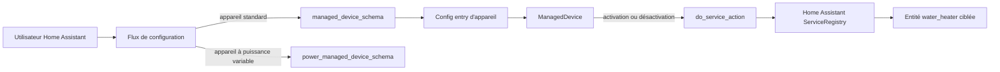
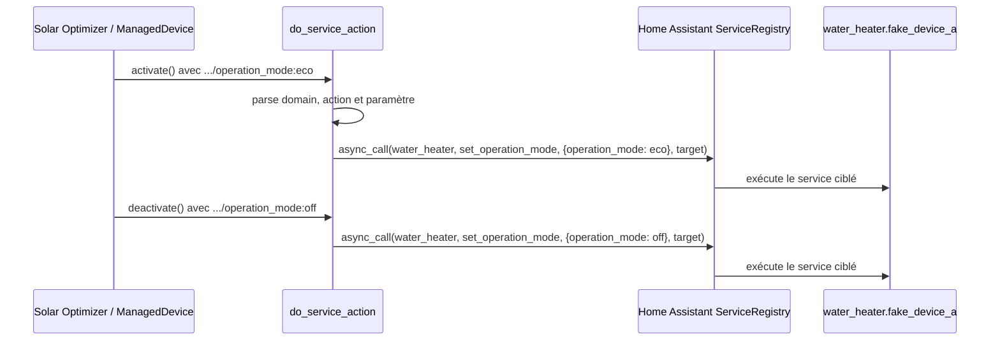

# Issue #212 - Conception technique : domaine `water_heater`

| Élément              | Valeur                                                                                        |
| -------------------- | --------------------------------------------------------------------------------------------- |
| Statut               | Prêt pour implémentation, sous réserve des validations listées                                |
| Version              | 1.1                                                                                           |
| Date                 | 2026-10-10                                                                                    |
| Propriétaire         | Projet Solar Optimizer                                                                        |
| Périmètre            | Appareil géré standard uniquement                                                             |
| Sources obligatoires | [Rapport de revue](issue-212-review.md), [spécification validée](issue-212-specifications.md) |

## 1. Objectif et périmètre

Permettre à un utilisateur de sélectionner une entité Home Assistant `water_heater` pour un appareil Solar Optimizer de type standard, puis de configurer librement ses actions, par exemple :

```text
activation   = water_heater/set_operation_mode/operation_mode:eco
désactivation = water_heater/set_operation_mode/operation_mode:off
```

Cette évolution étend uniquement la liste de domaines proposée par le sélecteur `managed_device_schema`. Elle réutilise le contrat d'appel de service existant et ne crée ni logique métier, ni service, ni état spécifique au chauffe-eau.

### Hors périmètre impératif

- Ne pas ajouter `water_heater` à `power_managed_device_schema`.
- Ne pas modifier `do_service_action`, l'algorithme, le format `domaine/service[/clé:valeur]`, les entrées de configuration existantes, les dépendances ou le frontend.
- Ne pas gérer deux entités pour un même appareil Solar Optimizer.
- Ne pas définir, traduire ou valider de catalogue global de modes (`eco`, `automatic`, `off`, etc.).

## 2. Éléments existants vérifiés

| Élément                                                                          | Fait vérifié                                                                                                                                         | Rôle pour cette évolution                                             |
| -------------------------------------------------------------------------------- | ---------------------------------------------------------------------------------------------------------------------------------------------------- | --------------------------------------------------------------------- |
| [`config_schema.py`](../../custom_components/solar_optimizer/config_schema.py)   | `managed_device_schema` expose une liste fermée de domaines, sans `water_heater`. `power_managed_device_schema` est distinct.                        | Point de changement fonctionnel unique.                               |
| [`config_flow.py`](../../custom_components/solar_optimizer/config_flow.py)       | `async_step_device` utilise `managed_device_schema`; `async_step_powered_device` utilise le schéma de puissance.                                     | Confirme la séparation des deux formulaires.                          |
| [`managed_device.py`](../../custom_components/solar_optimizer/managed_device.py) | `do_service_action` découpe `domaine/service/clé:valeur`, construit `service_data`, puis appelle `hass.services.async_call` avec `target.entity_id`. | Aucun changement requis pour `set_operation_mode`.                    |
| [`test_non_switch_device.py`](../../tests/test_non_switch_device.py)             | `test_climate_device` couvre le précédent `climate/set_hvac_mode/hvac_mode:<mode>` et inspecte l'appel mocké.                                        | Modèle direct du test de régression demandé.                          |
| [`manifest.json`](../../custom_components/solar_optimizer/manifest.json)         | Version de l'intégration : `3.8.1`; aucune version minimale de Home Assistant déclarée.                                                              | Compatibilité de l'import à confirmer lors de la validation.          |
| [`README-fr.md`](../../README-fr.md) et [`README.md`](../../README.md)           | Documentation utilisateur FR/EN existante, sans occurrence de `water_heater/set_operation_mode`.                                                     | Cibles probables de la documentation de livraison requise par AC-007. |

## 3. Architecture actuelle et responsabilités



| Composant                                 | Responsabilité actuelle                                                                        | Décision de conception                                                                                                                  |
| ----------------------------------------- | ---------------------------------------------------------------------------------------------- | --------------------------------------------------------------------------------------------------------------------------------------- |
| `managed_device_schema`                   | Déclare les champs du formulaire standard et les domaines affichés par `EntitySelector`.       | Importer `homeassistant.components.water_heater.DOMAIN` sous le nom `WATER_HEATER_DOMAIN`, puis l'ajouter une seule fois à cette liste. |
| `power_managed_device_schema`             | Déclare le formulaire d'appareil à puissance variable.                                         | Ne pas le modifier.                                                                                                                     |
| `ManagedDevice`                           | Stocke une unique valeur `entity_id`, les deux services configurés et délègue les actions.     | Inchangé : son modèle un appareil / une entité satisfait FR-005.                                                                        |
| `do_service_action`                       | Parse le service générique et appelle Home Assistant; journalise et intercepte les exceptions. | Inchangé : son comportement satisfait FR-003 et FR-004.                                                                                 |
| Intégration Home Assistant du chauffe-eau | Expose le service et décide de la validité du mode.                                            | Autorité sur les modes; Solar Optimizer ne les interprète pas.                                                                          |

## 4. Changement précis par fichier

### [`custom_components/solar_optimizer/config_schema.py`](../../custom_components/solar_optimizer/config_schema.py)

1. Ajouter l'import suivant avec les autres imports de domaines :

   ```python
   from homeassistant.components.water_heater import DOMAIN as WATER_HEATER_DOMAIN
   ```

2. Ajouter `WATER_HEATER_DOMAIN` à l'argument `domain=[...]` de l'`EntitySelectorConfig` de `managed_device_schema`.
3. Ne modifier ni la liste de `power_managed_device_schema`, ni les valeurs par défaut, ni les autres schémas.

Effet attendu : Home Assistant propose et accepte visuellement les entités `water_heater.*` uniquement dans la saisie d'un appareil standard.

### [`tests/test_non_switch_device.py`](../../tests/test_non_switch_device.py)

Ajouter un test asynchrone, par exemple `test_water_heater_device`, calqué sur `test_climate_device` :

1. Créer une `MockConfigEntry` standard avec `entity_id="water_heater.fake_device_a"`.
2. Configurer l'activation à `water_heater/set_operation_mode/operation_mode:eco` et la désactivation à `water_heater/set_operation_mode/operation_mode:off`.
3. Construire l'appareil via `create_managed_device`, puis appeler `activate()` sous mock de `homeassistant.core.ServiceRegistry.async_call`.
4. Vérifier l'appel : domaine `water_heater`, action `set_operation_mode`, `service_data={"operation_mode": "eco"}`, et `target={"entity_id": "water_heater.fake_device_a"}`.
5. Sous un second mock, appeler `deactivate()` et vérifier le même domaine, la même action et cible, avec `service_data={"operation_mode": "off"}`.

Ce test ne charge pas une intégration physique de chauffe-eau : il vérifie précisément le contrat entre Solar Optimizer et le registre de services, conformément au précédent `climate`.

### [`README-fr.md`](../../README-fr.md) et [`README.md`](../../README.md)

Lors de l'implémentation, mettre à jour les deux README :

- ajouter `water_heater` à la liste des domaines compatibles pour un appareil standard;
- ajouter, dans la section des exemples de configuration, un exemple YAML complet avec `entity_id: "water_heater.<nom>"`, `water_heater/set_operation_mode/operation_mode:eco` et `water_heater/set_operation_mode/operation_mode:off`;
- préciser que `eco` et `off` sont illustratifs et que les modes acceptés dépendent de l'intégration Home Assistant concernée.

La documentation utilisateur est un livrable obligatoire de l'issue, sans impact sur le comportement produit par le changement de schéma.

## 5. Modèle de données et contrats

### Données configurées

| Champ existant         | Exemple                                              | Contrat                                                                            |
| ---------------------- | ---------------------------------------------------- | ---------------------------------------------------------------------------------- |
| `entity_id`            | `water_heater.fake_device_a`                         | Une seule entité du domaine désormais proposé par le sélecteur standard.           |
| `activation_service`   | `water_heater/set_operation_mode/operation_mode:eco` | Chaîne générique à trois segments.                                                 |
| `deactivation_service` | `water_heater/set_operation_mode/operation_mode:off` | Indépendante de l'activation; aucune valeur n'est déduite.                         |
| `power_max`            | `1000`                                               | Donnée d'appareil standard préexistante; aucun contrat de modulation n'est ajouté. |

### Contrat vers Home Assistant

Pour une chaîne de la forme `water_heater/set_operation_mode/operation_mode:<mode>`, le contrat d'appel est :

| Élément        | Valeur attendue                                                                                  |
| -------------- | ------------------------------------------------------------------------------------------------ |
| `domain`       | `water_heater`                                                                                   |
| `service`      | `set_operation_mode`                                                                             |
| `service_data` | `{"operation_mode": "<mode>"}`                                                                   |
| `target`       | `{"entity_id": "water_heater.fake_device_a"}` dans le test, ou l'entité configurée en production |
| Idempotence    | Non garantie par Solar Optimizer; elle dépend du service Home Assistant appelé.                  |
| Délai          | Aucun délai spécifique ajouté; l'appel asynchrone conserve le comportement existant.             |

Le parseur existant ne gère qu'une paire `clé:valeur` et ne transforme pas la valeur. Le caractère `:` dans une valeur ne fait donc pas partie du contrat de cette évolution.

## 6. Flux de contrôle

### Configuration

1. L'utilisateur choisit le type d'appareil standard.
2. `async_step_device` présente `managed_device_schema`.
3. Après ajout de `WATER_HEATER_DOMAIN`, l'`EntitySelector` filtre aussi les entités `water_heater.*`.
4. L'utilisateur choisit une entité et saisit les services d'activation et de désactivation compatibles avec son intégration.
5. Le flux persiste les mêmes champs de config entry qu'auparavant; aucune migration n'est nécessaire.

### Activation et désactivation



L'optimisation décide quand appeler `activate()` ou `deactivate()` selon son fonctionnement actuel. Cette issue ne modifie ni cette décision, ni les temporisations, ni les états calculés.

## 7. Erreurs, reprise et exploitation

| Situation                                       | Comportement existant conservé                                                         | Décision                                                                                   |
| ----------------------------------------------- | -------------------------------------------------------------------------------------- | ------------------------------------------------------------------------------------------ |
| Service vide                                    | `do_service_action` journalise l'absence de service et retourne.                       | Aucun traitement spécifique au chauffe-eau.                                                |
| Format avec moins de deux segments              | `ConfigurationError` est levée.                                                        | Conserver le format générique; ne pas le corriger automatiquement.                         |
| Mode inconnu ou service indisponible            | Home Assistant peut lever une exception; elle est journalisée par `do_service_action`. | L'intégration du chauffe-eau reste responsable de ses capacités.                           |
| Redémarrage de Solar Optimizer / Home Assistant | Les config entries existantes sont relues avec leurs mêmes champs.                     | Aucune migration, aucune persistance nouvelle.                                             |
| Entité ou mode non disponible                   | Le formulaire ne vérifie pas dynamiquement les capacités du périphérique.              | Limite explicitement conservée; documenter les exemples comme dépendants de l'intégration. |

Le changement n'introduit ni secret, ni réseau, ni donnée personnelle, ni privilège supplémentaire. Il étend seulement l'ensemble d'entités que l'utilisateur peut choisir pour déclencher un service déjà configurable.

## 8. Stratégie de tests et plan de validation

### Test automatisé obligatoire

Exécuter le nouveau test `test_water_heater_device` dans [`tests/test_non_switch_device.py`](../../tests/test_non_switch_device.py). Il doit vérifier séparément activation et désactivation, avec les quatre dimensions suivantes : domaine, action, données et cible.

Commande cible, à adapter au lanceur de tests déclaré par le dépôt :

```bash
rtk pytest tests/test_non_switch_device.py -k water_heater
```

Ensuite exécuter le fichier analogue complet afin de détecter une régression sur les autres appareils non-switch :

```bash
rtk pytest tests/test_non_switch_device.py
```

Enfin exécuter la suite pertinente du projet avant livraison, suivant la commande projet disponible dans l'environnement.

### Vérification de l'interface de configuration

Le test de service ci-dessus crée directement une config entry et ne traverse donc pas l'interface du flux. Il ne peut pas démontrer AC-001 à lui seul. Effectuer une vérification ciblée dans Home Assistant :

1. ouvrir l'ajout d'un appareil standard Solar Optimizer et constater que `water_heater.fake_device_a` est sélectionnable;
2. ouvrir l'ajout d'un appareil à puissance variable et constater que ce domaine n'est pas proposé;
3. créer l'appareil avec les chaînes `eco` / `off`, puis confirmer les deux appels via le test automatisé ou les traces Home Assistant.

### Compatibilité de l'import

Dans l'environnement de test correspondant à la version Home Assistant réellement supportée, importer le module modifié et exécuter les tests ci-dessus. Le manifeste ne déclarant pas de version minimale, la version plancher à certifier demeure une décision de release.

## 9. Mapping des exigences et critères d'acceptation

| Critère                           | Couverture de conception                                                                                                                                                                   | Vérification                                                       |
| --------------------------------- | ------------------------------------------------------------------------------------------------------------------------------------------------------------------------------------------ | ------------------------------------------------------------------ |
| FR-001 / AC-001                   | Import `WATER_HEATER_DOMAIN` et ajout exclusif au sélecteur standard.                                                                                                                      | Vérification du formulaire standard et du formulaire de puissance. |
| FR-002                            | Aucune modification de `power_managed_device_schema`.                                                                                                                                      | Revue du diff; vérification du formulaire de puissance.            |
| FR-003                            | Conservation explicite de `do_service_action` et de son format générique.                                                                                                                  | Nouveau test avec la chaîne à trois segments.                      |
| FR-004 / AC-003 / AC-004 / AC-005 | Contrat d'appel défini pour `set_operation_mode`; `eco` à l'activation et `off` à la désactivation.                                                                                        | Assertions mockées sur domaine, action, données et `target`.       |
| FR-005                            | Une seule valeur `entity_id` est portée par `ManagedDevice`; aucun modèle multi-entité n'est introduit.                                                                                    | Construction d'une config entry à une entité; revue du diff.       |
| FR-006                            | Aucun enum, validation ou conversion de mode n'est ajouté.                                                                                                                                 | Revue du diff et des README de livraison.                          |
| FR-007                            | Liste ajoutée localement; moteur, schéma de puissance, frontend, dépendances et config entries inchangés.                                                                                  | Revue du diff et suite de tests pertinente.                        |
| AC-002                            | Test `water_heater.fake_device_a` avec activation `...:eco`.                                                                                                                               | Nouveau test ciblé.                                                |
| AC-006                            | Tests ciblé puis analogue complet, puis suite pertinente.                                                                                                                                  | Résultats de CI / environnement cible.                             |
| AC-007                            | Mise à jour obligatoire de `README-fr.md` et `README.md` : domaine ajouté à la liste et exemple YAML complet avec `eco` / `off`, présentés comme des valeurs dépendantes de l'intégration. | Revue des deux README avant livraison.                             |

## 10. Décisions, hypothèses, risques et questions ouvertes

### Décisions retenues

- Le domaine est ajouté à la liste fermée de l'appareil standard, plutôt qu'une autorisation générale de tous les domaines.
- Le moteur de service existant est réutilisé sans extension.
- Les modes restent des chaînes configurées par l'utilisateur et validées à l'exécution par l'intégration Home Assistant.
- La régression de service est localisée dans le fichier qui contient déjà le précédent `climate`.

### Hypothèses vérifiables

- La version Home Assistant supportée fournit `homeassistant.components.water_heater.DOMAIN`.
- Le banc de tests peut appeler `ManagedDevice` avec `water_heater.fake_device_a` sans charger de périphérique réel, comme avec `climate.fake_device_a`.
- `eco` et `off` sont des valeurs de test illustratives, non une liste de modes imposée.

### Risques et mesures

| Risque                                                       | Mesure                                                                                                     |
| ------------------------------------------------------------ | ---------------------------------------------------------------------------------------------------------- |
| Import absent dans une ancienne version de Home Assistant    | Certifier l'import dans la version minimale supportée avant release.                                       |
| L'utilisateur choisit un mode non exposé par son intégration | Documentation FR/EN indiquant que les modes sont propres à l'intégration; erreur Home Assistant conservée. |
| Régression par extension accidentelle du schéma de puissance | Exclusion explicite dans la revue de diff et vérification du formulaire de puissance.                      |
| Test qui ne couvre que le moteur, pas l'UI                   | Ajouter la vérification manuelle ciblée du sélecteur au plan de validation.                                |

### Question ouverte non bloquante

Quelle est la version minimale de Home Assistant officiellement supportée à certifier pour l'import `water_heater.DOMAIN` ? Le manifeste inspecté ne la déclare pas. L'implémentation minimale reste réalisable tant que l'environnement de support fournit ce module.

## 11. Conclusion de convergence

La conception converge avec la [spécification validée](issue-212-specifications.md) et le [rapport de revue](issue-212-review.md) : le périmètre est identique, les critères AC-001 à AC-007 sont tous mappés, et aucun changement interdit n'est requis. Le seul point à confirmer avant livraison est la version minimale Home Assistant à certifier; il ne bloque pas l'implémentation ni le test de la solution dans l'environnement cible.

---

# Issue #212 - Technical design: `water_heater` domain

| Item              | Value                                                                                        |
| ----------------- | -------------------------------------------------------------------------------------------- |
| Status            | Ready for implementation, subject to the listed validations                                  |
| Version           | 1.0                                                                                          |
| Date              | 2026-10-10                                                                                   |
| Owner             | Solar Optimizer project                                                                      |
| Scope             | Standard managed device only                                                                 |
| Mandatory sources | [Review report](issue-212-review.md), [validated specification](issue-212-specifications.md) |

## 1. Objective and scope

Allow a Home Assistant user to select a `water_heater` entity for a standard Solar Optimizer managed device and configure its actions freely, for example:

```text
activation   = water_heater/set_operation_mode/operation_mode:eco
deactivation = water_heater/set_operation_mode/operation_mode:off
```

The change extends only the domain list offered by `managed_device_schema`. It reuses the existing service-call contract and introduces no water-heater-specific business logic, service, or state.

### Mandatory exclusions

- Do not add `water_heater` to `power_managed_device_schema`.
- Do not change `do_service_action`, the optimizer, the `domain/service[/key:value]` format, existing configuration entries, dependencies, or the frontend.
- Do not manage two entities for one Solar Optimizer device.
- Do not define, translate, or validate a global mode catalog (`eco`, `automatic`, `off`, and so on).

## 2. Verified existing elements

| Element                                                                          | Verified fact                                                                                                                             | Role in this change                                       |
| -------------------------------------------------------------------------------- | ----------------------------------------------------------------------------------------------------------------------------------------- | --------------------------------------------------------- |
| [`config_schema.py`](../../custom_components/solar_optimizer/config_schema.py)   | `managed_device_schema` has a closed domain list without `water_heater`; `power_managed_device_schema` is separate.                       | Single functional change point.                           |
| [`config_flow.py`](../../custom_components/solar_optimizer/config_flow.py)       | `async_step_device` uses `managed_device_schema`; `async_step_powered_device` uses the power schema.                                      | Confirms the two forms are separated.                     |
| [`managed_device.py`](../../custom_components/solar_optimizer/managed_device.py) | `do_service_action` parses `domain/service/key:value`, builds service data, and calls `hass.services.async_call` with `target.entity_id`. | No `set_operation_mode` engine change is needed.          |
| [`test_non_switch_device.py`](../../tests/test_non_switch_device.py)             | `test_climate_device` covers `climate/set_hvac_mode/hvac_mode:<mode>` and inspects the mocked service call.                               | Direct model for the required regression test.            |
| [`manifest.json`](../../custom_components/solar_optimizer/manifest.json)         | Integration version is `3.8.1`; no minimum Home Assistant version is declared.                                                            | Import compatibility must be confirmed during validation. |
| [`README-fr.md`](../../README-fr.md) and [`README.md`](../../README.md)          | Existing French and English user documentation contains no `water_heater/set_operation_mode` reference.                                   | Likely delivery targets for AC-007 documentation.         |

## 3. Current architecture and responsibilities

The configuration flow directs standard devices to `managed_device_schema` and variable-power devices to `power_managed_device_schema`. A created configuration entry builds one `ManagedDevice`, which stores one entity identifier and two configured service strings. When the optimizer activates or deactivates the device, `do_service_action` parses the configured string and delegates the call to Home Assistant's service registry.

| Component                     | Current responsibility                                                                     | Design decision                                                                                              |
| ----------------------------- | ------------------------------------------------------------------------------------------ | ------------------------------------------------------------------------------------------------------------ |
| `managed_device_schema`       | Declares standard-form fields and domains shown by `EntitySelector`.                       | Import `homeassistant.components.water_heater.DOMAIN` as `WATER_HEATER_DOMAIN` and add it once to this list. |
| `power_managed_device_schema` | Declares the variable-power form.                                                          | Leave unchanged.                                                                                             |
| `ManagedDevice`               | Holds one `entity_id`, configured services, and delegates actions.                         | Leave unchanged; its one-device/one-entity model fulfills FR-005.                                            |
| `do_service_action`           | Parses the generic service syntax and invokes Home Assistant; logs and catches exceptions. | Leave unchanged; its current behavior fulfills FR-003 and FR-004.                                            |
| Water-heater integration      | Exposes the service and decides whether a mode is valid.                                   | Remains authoritative for modes; Solar Optimizer does not interpret them.                                    |

## 4. Exact file changes

### [`custom_components/solar_optimizer/config_schema.py`](../../custom_components/solar_optimizer/config_schema.py)

1. Add `from homeassistant.components.water_heater import DOMAIN as WATER_HEATER_DOMAIN` with the other domain imports.
2. Add `WATER_HEATER_DOMAIN` to the `EntitySelectorConfig(domain=[...])` list in `managed_device_schema` only.
3. Do not change `power_managed_device_schema`, defaults, or other schemas.

Expected result: the standard form offers `water_heater.*` entities; the variable-power form does not.

### [`tests/test_non_switch_device.py`](../../tests/test_non_switch_device.py)

Add an async `test_water_heater_device`, modeled after `test_climate_device`:

1. Create a standard `MockConfigEntry` for `water_heater.fake_device_a`.
2. Use activation `water_heater/set_operation_mode/operation_mode:eco` and deactivation `water_heater/set_operation_mode/operation_mode:off`.
3. Create the device, mock `homeassistant.core.ServiceRegistry.async_call`, and call `activate()`.
4. Assert domain `water_heater`, service `set_operation_mode`, `service_data={"operation_mode": "eco"}`, and `target={"entity_id": "water_heater.fake_device_a"}`.
5. In a separate mock context, call `deactivate()` and assert the same domain, service, and target with `service_data={"operation_mode": "off"}`.

The test needs no physical water-heater integration. It verifies the Solar Optimizer to Home Assistant service-registry contract, just as the `climate` test does.

### [`README-fr.md`](../../README-fr.md) and [`README.md`](../../README.md)

During implementation, update both README files: add `water_heater` to the supported standard-device domains; add a complete YAML example in their configuration-examples section with `entity_id: "water_heater.<name>"`, `water_heater/set_operation_mode/operation_mode:eco`, and `water_heater/set_operation_mode/operation_mode:off`; and explain that `eco` and `off` are illustrative because modes depend on the specific Home Assistant integration. This documentation is a mandatory issue deliverable.

## 5. Data model and contracts

| Existing field         | Example                                              | Contract                                                         |
| ---------------------- | ---------------------------------------------------- | ---------------------------------------------------------------- |
| `entity_id`            | `water_heater.fake_device_a`                         | One entity from the newly offered standard-device domain.        |
| `activation_service`   | `water_heater/set_operation_mode/operation_mode:eco` | Existing three-segment generic string.                           |
| `deactivation_service` | `water_heater/set_operation_mode/operation_mode:off` | Independent from activation; no value is inferred.               |
| `power_max`            | `1000`                                               | Existing standard-device value; no modulation contract is added. |

For `water_heater/set_operation_mode/operation_mode:<mode>`, the expected Home Assistant contract is domain `water_heater`, service `set_operation_mode`, service data `{"operation_mode": "<mode>"}`, and a target holding the configured entity id. Solar Optimizer does not guarantee idempotency or add a timeout; those properties remain those of the called Home Assistant service.

## 6. Control flows

Configuration flow: the user selects a standard device, `async_step_device` presents `managed_device_schema`, the selector includes `water_heater.*` after the change, and the existing fields are persisted without migration.

Execution flow: `activate()` parses `.../operation_mode:eco` and calls `water_heater.set_operation_mode` with the selected entity target and `{"operation_mode": "eco"}`. `deactivate()` performs the corresponding independent `off` call. The optimizer's decision logic, timing, and calculated states remain unchanged.

## 7. Errors, recovery, security, and operations

| Situation                           | Existing behavior retained                                                                         |
| ----------------------------------- | -------------------------------------------------------------------------------------------------- |
| Empty service                       | `do_service_action` logs and returns.                                                              |
| Fewer than two service segments     | `ConfigurationError` is raised.                                                                    |
| Unknown mode or unavailable service | Home Assistant may raise; `do_service_action` logs the exception.                                  |
| Restart                             | Existing configuration entries are reused unchanged; no migration or persisted data is introduced. |
| Integration-specific capabilities   | The form does not validate service availability or modes dynamically.                              |

No secret, network flow, personal-data processing, dependency, or privilege is introduced. The only operational change is allowing an additional user-selected entity domain to receive an already configurable service call.

## 8. Test strategy and validation plan

Automated validation must run the new `test_water_heater_device`, then the full analogous test file, and finally the relevant project suite:

```bash
rtk pytest tests/test_non_switch_device.py -k water_heater
rtk pytest tests/test_non_switch_device.py
```

The service test constructs a config entry directly, so it cannot itself prove selector rendering. Perform a focused Home Assistant configuration-flow check: confirm `water_heater.fake_device_a` is selectable for a standard device and absent from the variable-power form. In the supported Home Assistant test environment, also import the changed schema and run the above tests to certify `water_heater.DOMAIN` availability.

## 9. Requirements and acceptance-criteria mapping

| Criterion                         | Design coverage                                                                                   | Verification                                           |
| --------------------------------- | ------------------------------------------------------------------------------------------------- | ------------------------------------------------------ |
| FR-001 / AC-001                   | Add `WATER_HEATER_DOMAIN` only to the standard selector.                                          | Inspect both configuration forms.                      |
| FR-002                            | Do not modify `power_managed_device_schema`.                                                      | Diff review and variable-power-form check.             |
| FR-003                            | Keep `do_service_action` and its generic syntax.                                                  | New three-segment service test.                        |
| FR-004 / AC-003 / AC-004 / AC-005 | Defined `set_operation_mode` call contract for `eco` and `off`.                                   | Mock assertions for domain, service, data, and target. |
| FR-005                            | Existing single `entity_id` model is retained.                                                    | One-entity config-entry test and diff review.          |
| FR-006                            | Add no mode enum, validation, or translation.                                                     | Diff and delivery-documentation review.                |
| FR-007                            | Change remains local; engine, power schema, frontend, dependencies, and entries remain unchanged. | Diff and relevant suite.                               |
| AC-002                            | `water_heater.fake_device_a` test fixture with `...:eco`.                                         | New focused test.                                      |
| AC-006                            | Focused, analogous-file, and relevant-suite validation.                                           | CI or target-environment results.                      |
| AC-007                            | Plan French and English README updates during implementation.                                     | Review both README files before release.               |

## 10. Decisions, assumptions, risks, and open question

Decisions: use the existing closed standard-domain list, reuse the current service engine unchanged, keep modes user-configurable, and place the regression test beside the analogous climate test.

Verifiable assumptions: supported Home Assistant exposes `homeassistant.components.water_heater.DOMAIN`; the test harness accepts a simulated `water_heater.fake_device_a`; and `eco`/`off` are illustrative test values rather than mandatory modes.

Risks and mitigations: certify the import against the minimum supported Home Assistant version; document that modes are integration-specific; review the diff to prevent accidental extension of the power schema; and retain the dedicated selector-flow check because a direct `ManagedDevice` test does not cover UI selection.

Open, non-blocking question: what is the official minimum Home Assistant version to certify for `water_heater.DOMAIN`? The inspected manifest does not state it. The implementation remains feasible and testable in the target environment provided the module exists.

## 11. Convergence conclusion

This design converges with the [validated specification](issue-212-specifications.md) and [review report](issue-212-review.md): it has the same scope, maps AC-001 through AC-007 explicitly, and requires no forbidden change. The only item to confirm before release is the minimum Home Assistant version to certify; it does not block implementation or target-environment testing.