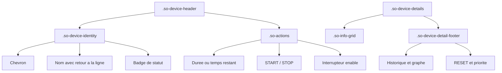

# Conception technique - ISSUE-216 - Carte responsive sur smartphone

## 1. Metadonnees

| Champ        | Valeur                                                                                       |
| ------------ | -------------------------------------------------------------------------------------------- |
| Statut       | Conception techniquement prete ; autorisation finale utilisateur requise avant developpement |
| Version      | 1.0                                                                                          |
| Date         | 2026-10-10                                                                                   |
| Proprietaire | Non defini dans les sources                                                                  |
| Perimetre    | Presentation HTML/CSS de `solar-optimizer-card` uniquement                                   |

### Sources verifiees

- [Revue de l'issue](issue-216-review.md)
- [Specification fonctionnelle](issue-216-specifications.md)
- [Specification de la carte](../../tech-docs/so-card-specifications.md)
- [Implementation frontend actuelle](../../custom_components/solar_optimizer/frontend/solar-optimizer-card.js)

Les faits ci-dessous sont fondes sur ces sources. Les classes a creer et les regles CSS proposees sont des decisions de conception pour l'implementation future ; elles ne sont pas presentes dans la version analysee.

## 2. Objectif et perimetre

Corriger le debordement horizontal de la carte dans une colonne Lovelace mobile de largeur comprise entre 320 et 767 px, sans retirer d'information ni de commande. La disposition desktop reste equivalente a l'existant a partir de 768 px.

La correction est limitee a `custom_components/solar_optimizer/frontend/solar-optimizer-card.js`, dans le gabarit HTML et les styles embarques. Elle ne modifie pas le backend, les entites, les attributs, les services, la configuration utilisateur, les traductions, les dependances ou Home Assistant.

## 3. Etat existant verifie

- La carte, `ha-card` et `.so-card-body` ont deja une largeur a `100%` et `box-sizing: border-box`.
- `.so-grid-stats` impose trois colonnes ; `.so-info-grid` en impose deux ; aucune media query n'est definie.
- `.so-device-header` juxtapose un groupe identite anonyme et `.so-actions`. Ce dernier contient deja, dans cet ordre DOM, la duree ou le temps restant, le bouton START/STOP, puis `ha-switch`.
- Le nom d'equipement n'a pas de regle explicite de reduction, et plusieurs conteneurs de detail utilisent des styles inline de type `display:flex`.
- Les ecouteurs sont reattaches apres chaque reconstruction a partir de classes et de `data-*` : `.device-duration-select`, `.so-priority-select`, `.device-toggle`, `.device-startstop`, `.device-reset-on-time`, `.so-collapse-btn[data-collapse-id]` et `.so-collapse-all`.
- Les appels conserves sont `switch.turn_on`, `switch.turn_off`, `select.select_option`, `solar_optimizer.start_device`, `solar_optimizer.stop_device` et `solar_optimizer.reset_on_time`. L'etat de pliage est conserve sous la cle `localStorage` `solar-optimizer-card-collapsed`.

## 4. Solution retenue

### 4.1 Structure HTML a adapter

Conserver chaque controle existant, son attribut `data-*`, son texte, son titre et sa position relative. Remplacer seulement les conteneurs de disposition anonymes ou inline par les classes suivantes :

| Zone                  | Classe proposee              | Contenu et responsabilite                                                                           |
| --------------------- | ---------------------------- | --------------------------------------------------------------------------------------------------- |
| Identite d'equipement | `.so-device-identity`        | Chevron individuel, `.so-device-name`, badge de statut. Autorise la reduction de la zone textuelle. |
| Actions               | `.so-actions` (existante)    | Duree ou temps restant, START/STOP, interrupteur. Reste le seul conteneur des controles d'en-tete.  |
| Ligne puissance       | `.so-device-power-row`       | Valeur `courante / maximale` et barre de puissance. Remplace le style inline actuel.                |
| Bas des details       | `.so-device-detail-footer`   | Colonne historique/graphe et colonne RESET/priorite. Remplace le style inline actuel.               |
| Commandes de detail   | `.so-device-detail-controls` | RESET et `.so-priority-control`, conserves dans leur ordre existant.                                |

Le parent `.so-device-header` conserve deux enfants dans cet ordre : `.so-device-identity`, puis `.so-actions`. A largeur mobile, le CSS les presente verticalement sans deplacement DOM. Les controles restent donc parcourus et lus dans le meme ordre qu'aujourd'hui.

### 4.2 Regles CSS de base et prevention du debordement

Les regles suivantes doivent etre ajoutees dans le bloc `<style>` encapsule par le selecteur `solar-optimizer-card`, sans selecteur global :

1. Definir `min-width: 0` sur les enfants flex susceptibles de retrecir : `.so-device-header`, `.so-device-identity`, `.so-actions`, `.so-device-power-row`, `.so-device-detail-footer`, leur colonne historique et `.so-secondary-info > span`.
2. Definir `min-width: 0` et `overflow-wrap: anywhere` sur `.so-device-name`, `.so-secondary-info > span`, `.so-info-label` et `.so-info-value`. Ne pas utiliser d'ellipsis : les donnees restent entierement accessibles.
3. Donner `max-width: 100%` aux controles et elements non secables : `.so-duration-select`, `.so-timed-remaining`, `.so-priority-select`, `.so-btn`, `ha-switch` et les badges. Le temps restant conserve `white-space: nowrap`, car il est un controle compact ; le retour a la ligne est porte par `.so-actions`.
4. Ajouter `min-width: 0` aux items de grille `.so-stat-box` et `.so-info-item`. Les valeurs de statistiques peuvent utiliser `overflow-wrap: anywhere` afin que `N/A` et une valeur longue ne forcent pas une colonne hors ecran.
5. Conserver `width: 100%` et `box-sizing: border-box` sur les conteneurs actuels ; ne pas ajouter `overflow-x: auto` ou `overflow: hidden` a la carte, car ces regles cacheraient le defaut au detriment de l'acces aux commandes.

### 4.3 Seuils responsive

| Zone disponible | Regles de presentation proposees                                                                                                                                                                                                                                                                      |
| --------------- | ----------------------------------------------------------------------------------------------------------------------------------------------------------------------------------------------------------------------------------------------------------------------------------------------------- |
| >= 768 px       | Preserver les regles desktop actuelles : statistiques en trois colonnes, en-tete horizontal, details en deux colonnes. Les protections `min-width: 0` et `overflow-wrap` peuvent rester actives, sans changement fonctionnel.                                                                         |
| 600 a 767 px    | Appliquer une grille de statistiques fluide, `repeat(auto-fit, minmax(120px, 1fr))`. `.so-device-header` et `.so-actions` utilisent `flex-wrap: wrap` : l'en-tete reste horizontal tant que l'espace le permet, puis les actions passent a la ligne sans depasser. Les details passent a une colonne. |
| 360 a 599 px    | `.so-device-header` devient une colonne. `.so-actions` occupe `width: 100%`, `flex-wrap: wrap` et une ligne dediee sous l'identite. Les statistiques restent fluides avec un minimum de 120 px ; les details sont sur une colonne.                                                                    |
| 320 a 359 px    | Meme disposition que 360-599 px. Les actions peuvent former plusieurs lignes ; leur ordre DOM reste duree/temps restant, START/STOP, interrupteur. La grille fluide accepte une ou deux statistiques par ligne selon la place reellement disponible.                                                  |

Les media queries sont donc `@media (max-width: 767px)` pour les regles communes tablette/mobile et `@media (max-width: 599px)` pour l'empilement impose des actions. La largeur de colonne, et non une hypothese sur le viewport, decide du comportement effectif. La compatibilite inferieure a 320 px reste hors perimetre.

### 4.4 Dispositions detaillees

- Sous 768 px, `.so-info-grid` passe explicitement a `grid-template-columns: minmax(0, 1fr)` afin que les donnees de disponibilite, heures creuses, seuil SOC et temps de marche restent lisibles.
- Sous 600 px, `.so-device-detail-footer` devient une colonne. L'historique et le graphique precedent RESET et la priorite, conformement a l'ordre DOM existant. `.so-device-detail-controls` devient une rangee avec retour a la ligne ou une colonne alignee au debut ; aucun controle ne doit etre aligne hors du bord droit.
- `.so-device-power-row` utilise une disposition flex avec une valeur a `flex: 0 1 auto` et une barre a `flex: 1 1 120px; min-width: 0`. Sous 360 px, le retour a la ligne est autorise et la barre prend `flex-basis: 100%` lorsqu'elle ne peut plus cohabiter avec la valeur.
- Les indicateurs conservent leur comportement actuel de retour a la ligne. Les barres d'historique, de puissance et le SVG conservent leur largeur de `100%` dans un parent reductible.

## 5. Invariants fonctionnels et contrats

La correction est purement structurelle et CSS. Les contrats suivants sont invariants :

| Element           | Invariant a preserver                                                                                                                                                           |
| ----------------- | ------------------------------------------------------------------------------------------------------------------------------------------------------------------------------- |
| Duree forcee      | Le `select.device-duration-select` reste avant `.device-startstop`; son `data-device-id`, son listener `change` et le stockage `_selectedDurations` sont inchanges.             |
| Temps restant     | `.so-timed-remaining` remplace visuellement le selecteur uniquement lorsqu'il est deja rendu par la logique actuelle ; il reste visible et non rogne.                           |
| START / STOP      | `.device-startstop` conserve les attributs `data-entity-id`, `data-device-id`, `data-is-active` et `data-is-forced`, ainsi que les appels de service actuels.                   |
| Activation        | `ha-switch.device-toggle` garde `data-entity-id`, le listener `change` et l'appel `switch.turn_on` ou `switch.turn_off`.                                                        |
| Priorite et RESET | Les classes, attributs et appels `select.select_option` et `solar_optimizer.reset_on_time` sont inchanges.                                                                      |
| Pliage            | Les classes `.so-device-details.hidden`, les chevrons et la persistance `localStorage` sont inchanges. Les details masques ne doivent pas etre supprimes par le CSS responsive. |
| Etats             | Les classes physiques, les badges ACTIF/MANUEL/ATTENTE/INACTIF/DESACTIVE et leurs couleurs actuelles sont inchanges.                                                            |

## 6. Cas limites et comportement attendu

| Cas                                                        | Decision de conception                                                                                                                                |
| ---------------------------------------------------------- | ----------------------------------------------------------------------------------------------------------------------------------------------------- |
| Nom tres long, sans espace                                 | Le nom coupe au besoin grace a `overflow-wrap: anywhere`; l'identite peut s'etendre verticalement mais ne pousse jamais les actions hors de la carte. |
| Traductions francaises longues                             | Les elements textuels peuvent envelopper leur texte. Les tailles de police et les libelles ne sont ni masques ni arbitrairement reduits.              |
| Activation minutee active                                  | Le badge temps restant garde sa largeur intrinseque et passe sur une ligne d'actions supplementaire avec START/STOP et l'interrupteur si necessaire.  |
| Aucune duree selectionnee                                  | Le selecteur est conserve, avec les memes options et listener ; il n'est ni remplace ni comprime a une largeur inferieure a son contenu.              |
| Priorite absente, puissance non configurable ou SOC absent | Les fragments conditionnels actuels restent conditionnels ; les conteneurs ne creent ni colonne vide obligatoire ni debordement.                      |
| Details ouverts                                            | La grille est monocolonne sous 768 px ; historique, graphe, RESET et priorite sont accessibles dans le flux vertical.                                 |
| Details fermes                                             | L'en-tete, la puissance et les actions restent accessibles. La regle `.hidden { display: none; }` continue de primer.                                 |
| Plusieurs equipements                                      | Chaque carte est independante ; le retour a la ligne de l'une ne modifie ni la largeur ni l'etat de pliage des autres.                                |

## 7. Gestion des erreurs, persistance et observabilite

La correction n'introduit aucun nouvel appel asynchrone, aucune persistance et aucun traitement d'erreur. Elle conserve les caches d'historique, les rafraichissements de temps force et les garde-fous existants contre une reconstruction pendant une interaction avec `select` ou `input`.

L'observabilite fonctionnelle repose sur la console Home Assistant et le comportement visible : aucun nouveau log n'est necessaire pour une modification CSS/HTML de presentation. Toute erreur JavaScript, listener non attache ou appel de service different observe pendant la recette est un echec de non-regression, pas un comportement degrade acceptable.

## 8. Strategie de validation

### 8.1 Verification statique ciblee

Apres implementation, verifier dans le fichier frontend que :

1. les nouvelles classes de disposition existent dans le gabarit et les regles CSS ;
2. l'ordre des descendants de `.so-actions` est strictement `duree/temps restant`, `.device-startstop`, `.device-toggle` ;
3. tous les selecteurs de listeners et `data-*` listes en section 5 sont inchanges ;
4. aucun changement n'est apporte aux appels `callService`, a `localStorage`, aux entites lues ou a la logique de calcul des etats.

### 8.2 Recette responsive visuelle et fonctionnelle

Realiser cette recette avec la carte reellement rendue dans un tableau de bord Home Assistant. Une simulation CSS isolee ne suffit pas, car les composants `ha-switch`, `ha-icon` et les themes sont fournis par Home Assistant.

Pour chaque combinaison langue `fr`/`en` et theme clair/sombre, verifier aux largeurs de zone de carte 320, 360, 390, 600 et 768 px :

1. verifier que `scrollWidth` ne depasse pas `clientWidth` pour `solar-optimizer-card`, `ha-card`, `.so-card-body` et chaque `.so-device-card` a 320, 360 et 390 px ;
2. controler les cinq statistiques, avec des valeurs longues et `N/A` : toutes sont visibles, lisibles et non superposees ;
3. controler un appareil au nom long, sans espace, en etats ACTIF, ATTENTE, INACTIF, DESACTIVE et MANUEL ; le nom, badge, puissance, duree/temps restant, START/STOP et interrupteur restent visibles et manipulables ;
4. controler separement l'absence de duree, une duree selectionnee, une activation forcee minutee avec temps restant inferieur puis superieur a une heure ;
5. ouvrir les details d'un appareil avec disponibilite puissance, heures creuses, seuil SOC, historique, graphique, RESET et priorite, puis confirmer l'acces tactile et clavier a chaque commande ;
6. tester le pliage individuel, le pliage global et le rechargement de la page afin de verifier la restauration d'etat ;
7. executer activation/desactivation, START, STOP, activation forcee minutee, RESET et changement de priorite, puis verifier les memes entites et appels de service qu'avant ;
8. a 768 px, comparer au rendu de reference desktop : aucune information ou commande ne disparait et l'en-tete reste equivalent a l'existant.

Capturer une image par largeur pour chaque scenario d'encombrement (nom long, details ouverts, activation minutee). Toute barre de defilement horizontale, zone tactile qui chevauche une autre, texte rogne ou controle hors ecran bloque la validation.

## 9. Coherence avec la specification et tracabilite

| Exigences / criteres               | Couverture par la conception                                                                                                                |
| ---------------------------------- | ------------------------------------------------------------------------------------------------------------------------------------------- |
| FR-001 a FR-003, AC-001 a AC-002   | Largeur contrainte, protections contre debordement et grille de statistiques fluide validee a 320/360/390 px.                               |
| FR-004 a FR-009, AC-003 a AC-004   | Groupes identite/actions nommes, actions en ligne dediee mobile, retour a la ligne, ordre DOM conserve et coupure des noms longs.           |
| FR-010 a FR-013, AC-005 a AC-006   | Details monocolonne, pied de detail reorganise visuellement, pliage et classes d'etat inchanges.                                            |
| NFR-001 a NFR-006, AC-007 a AC-012 | Surface limitee au frontend, listeners/services/entites inchanges, recette langues/themes/etats et preservation desktop a partir de 768 px. |

Les decisions de la specification sont respectees : minimum garanti de 320 px, actions regroupees sous l'identite sur mobile, aucune information ou action masquee, et aucune modification backend.

## 10. Risques residuels, hypotheses et decision

| Sujet                              | Statut et traitement                                                                                                                                                          |
| ---------------------------------- | ----------------------------------------------------------------------------------------------------------------------------------------------------------------------------- |
| Composants Home Assistant          | `ha-switch` peut avoir une largeur intrinseque dependante de la version ou du theme. La recette dans le tableau de bord reel est obligatoire.                                 |
| Valeurs exceptionnellement longues | Les regles de coupure couvrent le texte libre ; les controles natifs restent proteges par `max-width: 100%` et le retour a la ligne de leur conteneur.                        |
| Largeur de colonne                 | Une colonne Lovelace peut etre plus etroite que le viewport. Les media queries et la grille fluide s'appliquent a la largeur disponible ; la garantie reste limitee a 320 px. |
| Mode edition                       | Les sources ne confirment pas le defaut en mode edition. Il est hors criteres d'acceptation et ne bloque pas cette correction.                                                |

Il n'existe aucune contradiction bloquante entre la revue, les specifications, la documentation de la carte et l'implementation analysee. La conception est techniquement realisable par une modification localisee du gabarit HTML et du CSS du frontend. Cette faisabilite ne vaut pas autorisation de developper : l'implementation reste soumise a la validation finale explicite de l'utilisateur.