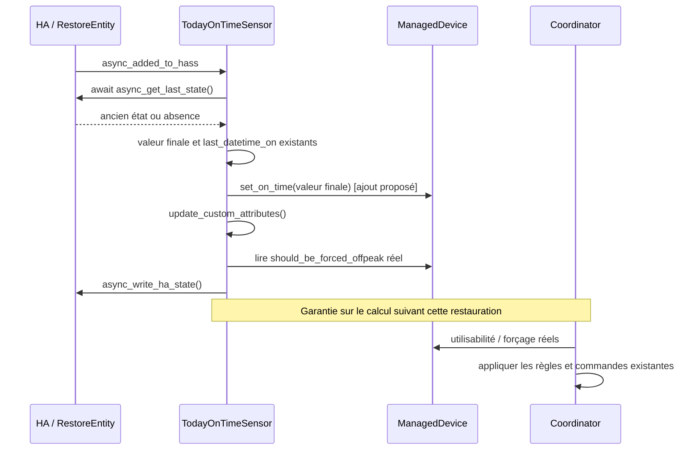
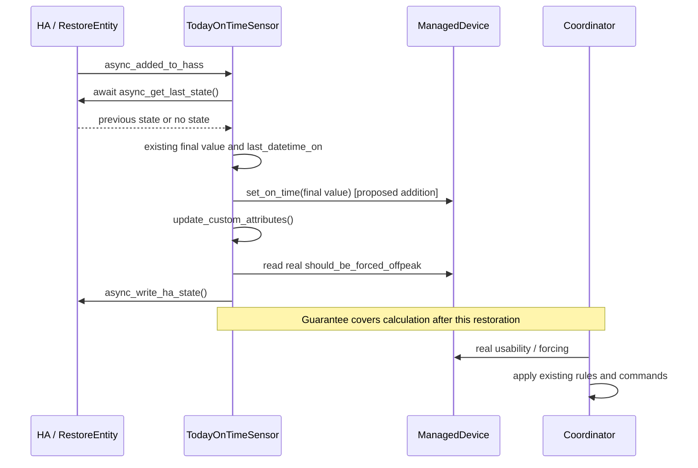

# Conception détaillée / Detailed design - Issue #222

## 1. Métadonnées / Metadata

| Élément / Item                         | Valeur / Value                                                                                                                                                                                                                                                                                                                                                                                                                                                                                                                                                                                                                                                |
| -------------------------------------- | ------------------------------------------------------------------------------------------------------------------------------------------------------------------------------------------------------------------------------------------------------------------------------------------------------------------------------------------------------------------------------------------------------------------------------------------------------------------------------------------------------------------------------------------------------------------------------------------------------------------------------------------------------------- |
| Version                                | 1.0                                                                                                                                                                                                                                                                                                                                                                                                                                                                                                                                                                                                                                                           |
| Date                                   | 2026-11-09                                                                                                                                                                                                                                                                                                                                                                                                                                                                                                                                                                                                                                                    |
| Propriétaire / Owner                   | Projet Solar Optimizer / Solar Optimizer project                                                                                                                                                                                                                                                                                                                                                                                                                                                                                                                                                                                                              |
| Statut / Status                        | Troisième et dernier cycle de clôture documentaire terminé ; accord de fond et convergence acquis au deuxième, inchangés ; confirmations finales des deux spécialistes acquises sur les versions actuelles ; présentation à l'utilisateur et approbation humaine distincte des résultats encore attendues ; développement non autorisé / Third and final documentary closure cycle completed; substantive agreement and convergence reached at the second cycle, unchanged; both specialists' final confirmations obtained on the current versions; presentation to the user and separate human approval of results still pending; development not authorized |
| Autorisation / Authorization           | « Je confirme. Go pour spec/design » ; développement non autorisé / Spec/design authorized; development not authorized                                                                                                                                                                                                                                                                                                                                                                                                                                                                                                                                        |
| Sources normatives / Normative sources | [Rapport approuvé / Approved review](issue-222-review.md), [spécifications bilingues v1.0 / bilingual specifications v1.0](issue-222-specifications.md), lus intégralement / read in full                                                                                                                                                                                                                                                                                                                                                                                                                                                                     |
| Besoin / Need                          | [Issue #222](https://github.com/jmcollin78/solar_optimizer/issues/222)                                                                                                                                                                                                                                                                                                                                                                                                                                                                                                                                                                                        |
| Livrable / Deliverable                 | Document bilingue unique / Single bilingual document                                                                                                                                                                                                                                                                                                                                                                                                                                                                                                                                                                                                          |

Les sections françaises 2 à 10 ont leur équivalent anglais ci-dessous. Les identifiants FR, BR et AC désignent les exigences, règles et critères des spécifications, sans les redéfinir. Les identifiants T désignent des tests futurs, pas des tests exécutés.

French sections 2 through 10 have matching English sections below. FR, BR and AC identifiers refer to specification requirements, rules and criteria without redefining them. T identifiers denote future tests, not executed tests.

---

# Version française

## 2. Objectif et périmètre

Rendre cohérents le capteur de durée quotidienne et le compteur métier dès la fin de restauration, avant les attributs initiaux et la publication, afin que le premier calcul suivant cette restauration applique les seuils existants. Couverture : FR-001 à FR-007, BR-001 à BR-004, AC-001 à AC-009 et les neuf critères du rapport.

**Décision D-01 :** réutiliser `ManagedDevice.set_on_time` avec la valeur définitive du capteur, après restauration de la valeur et de `last_datetime_on`, hors de `if old_state`, avant `update_custom_attributes()` puis `async_write_ha_state()`. Une affectation, aucun ajout de durée, aucun nouveau stockage.

Sont exclus : nouvelle politique de temps pendant l'arrêt ou de remise à zéro manquée, traitement nouveau de NaN/Inf, négatifs ou dates malformées, modification de l'algorithme, API, verrou, ordre général de démarrage, configuration, dépendances, frontend et entités existantes. La présente phase ne crée aucun test ni correctif et ne démarre pas Home Assistant.

## 3. Existant vérifié et dépendances

| Source inspectée                                                                                               | Faits locaux et responsabilité existante                                                                                                                                                                                                                                                                                                               |
| -------------------------------------------------------------------------------------------------------------- | ------------------------------------------------------------------------------------------------------------------------------------------------------------------------------------------------------------------------------------------------------------------------------------------------------------------------------------------------------ |
| [sensor.py](../../custom_components/solar_optimizer/sensor.py)                                                 | `async_setup_entry` retrouve ou crée le `ManagedDevice`, l'enregistre au coordinateur, puis ajoute `TodayOnTimeSensor`. Celui-ci hérite de `SensorEntity, RestoreEntity`. `async_added_to_hass` installe les abonnements, initialise zéro, attend `async_get_last_state`, restaure valeur/date, calcule les attributs puis publie, sans setter métier. |
| [managed_device.py](../../custom_components/solar_optimizer/managed_device.py)                                 | Le constructeur initialise `_on_time_sec = 0`. `set_on_time(on_time_sec: int)` affecte ce champ et journalise, sans commande. `check_usable(False)` et `should_be_forced_offpeak` lisent ce champ.                                                                                                                                                     |
| [coordinator.py](../../custom_components/solar_optimizer/coordinator.py)                                       | `configure` programme les rafraîchissements et peut souscrire aux changements de puissance. `_async_update_data` appelle le recuit puis lit `should_be_forced_offpeak` lors de l'application de la meilleure solution. `on_ha_started` journalise seulement.                                                                                           |
| [__init__.py](../../custom_components/solar_optimizer/__init__.py)                                             | Les plateformes sont transmises à HA ; un abonnement `homeassistant_started` appelle `on_ha_started`. Aucun verrou de restauration n'y est établi.                                                                                                                                                                                                     |
| [simulated_annealing_algo.py](../../custom_components/solar_optimizer/simulated_annealing_algo.py)             | `recuit_simule` lit réellement `device.is_usable`, qui appelle `check_usable(True)`, et renseigne `is_usable` dans `_equipements` pour le calcul. Pas de modification proposée.                                                                                                                                                                        |
| [conftest.py](../../tests/conftest.py), [commons.py](../../tests/commons.py)                                   | Fixtures `hass`, `init_solar_optimizer_central_config` (RAZ 05:00), `reset_coordinator` disponible ; helpers `create_managed_device`, `search_entity`, `create_test_input_boolean`. `create_managed_device` charge l'entrée avant de rendre l'appareil : l'injection doit donc précéder cet appel.                                                     |
| [test_min_on_time.py](../../tests/test_min_on_time.py), [test_max_on_time.py](../../tests/test_max_on_time.py) | Patrons `MockConfigEntry`, horloge `_set_now`, recherche du capteur, appels `_on_update_on_time` et `_on_midnight`. Le comptage existant vérifie 13 s, 68 s, RAZ puis 12 minutes. Certains tests minimum simulent des décisions : ne pas reproduire cela dans les nouveaux tests de restauration.                                                      |
| [test_power_device.py](../../tests/test_power_device.py)                                                       | Patron de calcul coordinateur avec puissances/coûts HA de test, résultat déterministe injecté de `recuit_simule` et `AsyncMock` sur les commandes. Réutiliser ce patron sans simuler les décisions métier.                                                                                                                                             |

Consignes consultées : [consignes du dépôt](../../.github/copilot-instructions.md) (commandes préfixées `rtk`) et [consignes Python locales](../../.github/agents/python.agent.md) pour le futur développement ; aucune consigne dédiée HA/AppDaemon supplémentaire identifiée dans les fichiers de consignes recherchés. [setup.cfg](../../setup.cfg), [pyproject.toml](../../pyproject.toml) définissent les tests asynchrones ; [testus.yaml](../../.github/workflows/testus.yaml) exécute la suite et la couverture sous Python 3.14. Aucune dépendance installée ou changée ici.

## 4. Composants et ordre de correction

| Composant              | Entrées                                           | Sorties et responsabilité dans la solution                                                                                                             |
| ---------------------- | ------------------------------------------------- | ------------------------------------------------------------------------------------------------------------------------------------------------------ |
| `RestoreEntity` / HA   | Identifiant du capteur, état antérieur disponible | Fournir l'état au chemin de restauration existant ; aucune nouvelle lecture de stockage.                                                               |
| `TodayOnTimeSensor`    | État précédent, attribut `last_datetime_on`       | Retenir la durée, restaurer la date, synchroniser le compteur, calculer les attributs et publier. Seul point de code à modifier lors du développement. |
| `ManagedDevice`        | Durée définitive via setter                       | Conserver la copie métier utilisée par les décisions ; aucune modification de classe nécessaire.                                                       |
| Coordinateur et recuit | Appareils et données énergétiques existants       | Lire les décisions cohérentes au calcul suivant la restauration ; conserver les commandes et règles actuelles.                                         |

Ordre exact prévu dans `TodayOnTimeSensor.async_added_to_hass` :

1. Conserver `await super().async_added_to_hass()` et les trois abonnements existants, avec leurs désabonnements.
2. Conserver `_attr_native_value = 0`, puis `old_state = await self.async_get_last_state()`.
3. Conserver sans modification le filtrage, `round(float(old_state.state))`, les exceptions actuellement prises en charge et la restauration `datetime.fromisoformat` de la date disponible.
4. **Ajouter uniquement** `self._device.set_on_time(self._attr_native_value)` après l'ensemble de `if old_state is not None`, à son niveau d'indentation extérieur.
5. Conserver immédiatement après `self.update_custom_attributes()` puis `self.async_write_ha_state()`.

**Hypothèse locale falsifiable H-01 :** cette affectation suffit à rendre les décisions cohérentes, car leurs lecteurs utilisent `_on_time_sec` et le retour anticipé de l'actualisation inactive ne l'écrit pas. Vérification discriminante : T-01 observe l'égalité avant attributs/publication et T-02/T-04 appellent les lecteurs réels sans actualisation préalable. Avant correction, ces contrôles doivent révéler la désynchronisation ; après correction, ils doivent réussir.

## 5. Données, persistance et états

| Donnée                 | Contrat et durée de vie                                                                                                                                                                 |
| ---------------------- | --------------------------------------------------------------------------------------------------------------------------------------------------------------------------------------- |
| `_attr_native_value`   | Valeur native du capteur, en secondes (`UnitOfTime.SECONDS`), entier issu de `round(float(...))` ou repli zéro sur les chemins gérés. Référence unique de l'affectation.                |
| `_device._on_time_sec` | Copie métier en mémoire, même unité ; initialement zéro. Remplacée via le setter, pas incrémentée lors de la restauration. Aucun stockage propre ajouté.                                |
| `_last_datetime_on`    | `None` ou `datetime` restauré depuis l'attribut ISO existant ; conservé tel que produit par le chemin actuel. La correction ne le change pas et ne calcule aucun intervalle.            |
| Seuils                 | Configuration en minutes, lecteurs métier en secondes. Pas de conversion supplémentaire ; minimum, maximum journalier et plafond heures creuses inchangés.                              |
| Identifiants           | Capteur existant `sensor.on_time_today_solar_optimizer_<idx>` et entité sous-jacente `device.entity_id` ; privilégier ces identifiants aux identifiants d'appareil HA. Aucun renommage. |

États conceptuels, sans nouvelle machine à états implémentée : initialisé à zéro → lecture de restauration en attente → valeur/date définitives → compteur synchronisé → attributs calculés → état publié. Le calcul suivant utilise ensuite le compteur courant ; des évolutions légitimes ultérieures (comptage/RAZ) ne doivent pas être écrasées par une relecture artificielle.

Compatibilité : même entité, unité, valeur arrondie, attributs et mécanisme `RestoreEntity`. `async_will_remove_from_hass` garde son appel existant à `async_dump_states`. Pas de migration ni nouvel enregistrement, service, événement ou paramètre de configuration.

## 6. Interfaces et contrats

| Interface existante             | Contrat conservé ou ajout local                                                                                                                                                                                                       |
| ------------------------------- | ------------------------------------------------------------------------------------------------------------------------------------------------------------------------------------------------------------------------------------- |
| `async_get_last_state()`        | Lecture asynchrone d'un état précédent ou absence d'état. Aucun délai maximal n'est établi dans les sources examinées ; aucun timeout/retry ajouté.                                                                                   |
| `set_on_time(on_time_sec: int)` | Appel synchrone avec la durée finale en secondes, y compris zéro. Affectation idempotente pour une même valeur, sans I/O de commande ni recomptage. Ne signifie pas que tout le cycle de vie HA peut être rappelé sans effet.         |
| `update_custom_attributes()`    | Appel synchrone après setter ; lit réellement `should_be_forced_offpeak`. Le premier attribut reflète la durée retenue.                                                                                                               |
| `async_write_ha_state()`        | Publication après attributs et setter, avec valeur et attribut cohérents à cette fin de restauration. Pas de nouvelle promesse sur les publications périodiques/RAZ.                                                                  |
| `check_usable(False)`           | Faux si durée ≥ maximum journalier ; sinon règles existantes de gabarit et disponibilité. Variante `True` / `is_usable` conserve aussi le contrôle batterie applicable à l'optimisation.                                              |
| `should_be_forced_offpeak`      | Lecteur réel : `check_usable(False)`, plage heures creuses, durée strictement inférieure au minimum, au maximum journalier et au plafond heures creuses. Ne commande rien.                                                            |
| `_async_update_data()`          | Au calcul post-restauration, le recuit lit l'utilisabilité réelle ; le coordinateur peut activer un appareil inactif si solution active ou forçage vrai. Un minimum atteint interdit le forçage, pas une activation normale légitime. |

Pas de nouveau contrat public, verrou, accusé de réception ou événement « restauration terminée ». La fin désigne ici la sortie normale du chemin de restauration décrit.

## 7. Flux, repli et reprise



- **Appareil éteint sans intervalle :** restauration non nulle, copie métier immédiate ; `_on_update_on_time` puis `_refresh_on_time` peuvent sortir sans rien changer. Aucun besoin d'attendre ce tick ni de commander l'appareil.
- **Minimum :** à 02:03, heures creuses 02:00, RAZ 05:00, minimum 7 200 s, les valeurs 24 600, 7 800 et 7 200 s excluent le forçage ; 7 140 s le permet uniquement si les autres conditions sont favorables. Hors plage ou plafond bloquant : pas de forçage.
- **Maximum :** avec maximum 7 200 s, 7 140 s n'est pas bloqué pour ce motif ; 7 200 et 7 800 s sont inutilisables. Le contrôle maximum de `check_usable` intervient avant les autres conditions, notamment avant l'évaluation du forçage.
- **Repli courant :** absence d'état, valeur `None`, `unknown` ou `unavailable` laissent zéro ; texte non numérique traité par `ValueError`/`TypeError` produit zéro et l'avertissement existant. Une date bien formée disponible reste restaurée même si la durée est en repli. Le setter est appelé aussi sans ancien état.
- **Appareil actif :** affecter uniquement la durée restaurée ; ne pas modifier la date et ne pas appeler `_refresh_on_time` pendant la restauration. Au prochain tick, conserver le calcul actuel de l'intervalle et le déplacement de la date vers `now` ; une répétition au même instant ajoute zéro. Cela ne définit pas une politique nouvelle de temps d'arrêt.
- **RAZ :** conserver `_on_midnight` : zéro, date repositionnée à `now` si intervalle présent, attributs/publication puis setter existants. Ne pas déplacer ces appels dans ce correctif ; contrôler les compteurs après retour du callback, sans imposer une nouvelle garantie d'attributs à cet instant.
- **Erreurs hors chemin géré :** ne pas étendre le `try/except`, notamment pour date malformée ou débordement numérique. NaN/Inf, négatifs et dates invalides ne sont pas assimilés au repli géré. Les erreurs de restauration/HA non gérées actuellement restent sans nouveau mécanisme de reprise.
- **Annulation/retrait/redémarrage :** aucune interception nouvelle d'annulation ; si la lecture est interrompue, la fin normale et sa garantie ne sont pas atteintes. Préserver les désabonnements et la sauvegarde existants. Au prochain ajout normal, le même chemin est utilisé ; pas de deuxième stockage ni rejeu de commandes.

**Limite de démarrage vérifiée :** l'appareil peut être enregistré avant l'ajout du capteur, les abonnements du capteur sont installés avant l'attente de restauration, et le coordinateur programme des rafraîchissements. Les sources locales n'établissent pas l'absence de calcul avant restauration. Après le retour de la lecture, le bloc final valeur/date → setter → attributs → publication ne contient pas de nouvel `await` ; ce fait ne démontre pas une barrière globale. Toute demande de garantie antérieure serait une extension à soumettre, pas un verrou à ajouter.

## 8. Sécurité, observabilité et exploitation

Aucun nouveau droit, secret, accès réseau, service ou flux de données. Le test utilise uniquement le `hass` de fixture ; ne pas lire les secrets ni les états d'une installation réelle. Les appels d'activation sont observés ou simulés, jamais envoyés à un équipement physique.

L'information de restauration, l'avertissement sur texte invalide et le journal existant de `set_on_time` suffisent à diagnostiquer la valeur retenue. Un appel de journalisation supplémentaire du setter par ajout de capteur est attendu ; aucun nouvel attribut, métrique ou journal privé nécessaire. Observer la valeur publiée et `should_be_forced_offpeak`, puis les décisions du premier calcul post-restauration.

Risques : test rendu faussement vert par décision simulée, mauvais instant d'injection, inspection seulement après un tick ou valeur zéro déjà initialisée. Les contrôles d'ordre, le spy appelant le setter réel et les seuils non nuls réduisent ces risques. Les calendriers, gabarits et disponibilités doivent rester déterministes dans les tests. La revue rapporte 16 cas réussis ; le total après ajout sera supérieur, sans prétendre à un nouveau résultat acquis.

## 9. Stratégie de tests et vérification

### Montage proposé, réalisable avec les points observés

Tests persistants futurs dans [test_min_on_time.py](../../tests/test_min_on_time.py) (restauration, minimum, publication et coordinateur) et [test_max_on_time.py](../../tests/test_max_on_time.py) (maximum, actif, comptage et RAZ). Réutiliser les helpers et fixtures existants ; aucune nécessité établie de nouveau fichier ou de modification de fixture globale.

1. Utiliser `hass`, `init_solar_optimizer_central_config`, `MockConfigEntry`, `create_managed_device` et `search_entity`. Créer l'`input_boolean` de test avant le chargement de l'entrée appareil, éteint ou allumé selon le scénario. Configurer des durées de disponibilité non bloquantes, gabarit d'utilisabilité vrai, plafond journalier/offpeak compatible avec le minimum et batterie non bloquante.
2. Avant `create_managed_device`, injecter avec un patch asynchrone de `RestoreEntity.async_get_last_state`, méthode réellement héritée par `TodayOnTimeSensor`. Limiter le résultat au seul `entity_id` du capteur ciblé ; déléguer les autres entités à la méthode originale. Employer `State` avec valeur chaîne et attribut ISO valide pour les cas normaux ; retourner `None` pour absence d'état. Pour la valeur brute `None`, utiliser un double minimal avec `.state = None` et `.attributes = {}` : ne pas supposer que `State` conserve un `None` brut. Cette injection teste le contrat du lecteur sans écrire le stockage réel et ne constitue pas un redémarrage HA.
3. Fixer l'heure avant l'exécution de la restauration : un patch limité de la propriété `ManagedDevice.now` peut fournir le datetime conscient du fuseau de `get_tz(hass)` lors du chargement. Après chargement, utiliser `_set_now` pour les évolutions, comme les tests actuels. Pour les seuils initiaux, le constructeur fixe ainsi sa disponibilité au même instant ; ne pas corriger le compteur par setter depuis le test.
4. Installer avant chargement des wrappers synchrones de classe sur `set_on_time`, `update_custom_attributes` et `async_write_ha_state`, filtrés sur l'appareil/capteur ciblé et déléguant aux méthodes originales. Capturer l'ordre et les valeurs au moment des appels. À l'entrée des attributs et à la publication, affirmer égalité avec `_on_time_sec`, date restaurée et appel du setter déjà effectué. Capturer une copie des attributs de la première publication, pas une référence mutable ; vérifier aussi `hass.states` après les tâches HA. Conserver le calcul réel des attributs et décisions.
5. Retrouver le capteur avec `search_entity`, attendre `hass.async_block_till_done` pour les tâches de chargement, puis lire `should_be_forced_offpeak`, `check_usable(False)` et `is_usable` réels. Ne pas patcher ces trois lecteurs ni remplacer la propriété métier par le booléen attendu. Ne déclencher aucun tick pour obtenir l'égalité initiale.
6. Pour le calcul coordinateur, reprendre les entrées de puissance/coûts du patron voisin et injecter dans `recuit_simule` une solution déterministe `[{"name": device.name, "requested_power": 0, "state": False}]` avec objectif/puissance nuls ; observer `activate`/`deactivate` via `AsyncMock`. Ce test conserve `_async_update_data` et le forçage réels mais ne certifie pas le recuit. Pour la consommation du maximum par le recuit réel, exécuter séparément `recuit_simule` avec les mêmes entrées valides et contrôler le champ `is_usable` de l'appareil dans `_equipements` ; ne pas imposer une solution aléatoire précise ni simuler `is_usable`. Ce point interne est un choix de test local déjà accessible, pas une nouvelle API.

### Cas et résultats attendus

| Test futur | Scénario concret et assertions                                                                                                                                                                                                                                                                                                                                 | Emplacement préféré |
| ---------- | -------------------------------------------------------------------------------------------------------------------------------------------------------------------------------------------------------------------------------------------------------------------------------------------------------------------------------------------------------------- | ------------------- |
| T-01       | Restaurer 7 800 s éteint, sans date. Setter réel appelé une fois avec 7 800 après lecture/date, avant attributs et première publication ; compteur et capteur égaux à ces observations. Variante numérique fractionnaire pour conserver `round(float(...))`.                                                                                                   | Minimum             |
| T-02       | À 02:03 / 02:00 / 05:00, min 7 200 s, plafonds non bloquants : paramétrer 24 600, 7 800, 7 200 → faux ; 7 140 → vrai. Vérifier attribut initial et lecteur réel sans tick préalable.                                                                                                                                                                           | Minimum             |
| T-03       | Durée 7 140 s, min 7 200 s : hors plage → faux ; autre variante dans la plage avec disponibilité bloquante → faux. Pour le plafond offpeak, configurer minimum et plafond compatibles et restaurer à égalité du plafond → faux. Ne pas introduire min > maximum pour forcer un cas invalide.                                                                   | Minimum             |
| T-04       | Max 7 200 s, minimum zéro : 7 140 → utilisable ; 7 200, 7 800 → inutilisable via `check_usable(False)` et `is_usable`. Le recuit réel reçoit ces décisions dans `_equipements`. Vérifier aussi que le contrôle maximum bloque le forçage à égalité avec une configuration min = max valide.                                                                    | Maximum             |
| T-05       | Restaurer 7 800 s éteint sans date, appeler `_on_update_on_time` : mêmes compteurs, date absente, aucun appel d'activation.                                                                                                                                                                                                                                    | Minimum             |
| T-06       | Absence d'état, valeur brute `None`, `unknown`, `unavailable`, texte invalide, sans date malformée : setter appelé une fois avec zéro avant attributs/publication et aucune nouvelle exception. Le spy d'appel est indispensable : zéro initial seul ne prouve pas la correction. Variante avec date ISO valide pour vérifier sa conservation même avec repli. | Minimum             |
| T-07       | Après restauration, premier `_async_update_data` explicitement invoqué sans tick intermédiaire, solution normale éteinte : 7 800/min 7 200 → aucune activation ; 7 140 → une activation possible attendue. Attribut initial, état HA publié et compteur concordent. Les lecteurs métier restent réels.                                                         | Minimum             |
| T-08       | Actif, restaurer 600 s et date valide t0. À restauration : 600 s et date inchangée. À t0+60 s, tick → 660 s ; répéter au même instant → 660 s. À la RAZ appelée avec heure contrôlée : compteurs zéro, date au nouvel instant ; à +60 s actif → 60 s. Aucun intervalle ajouté par la synchronisation ; conserver aussi le test de gabarit actif retardé.       | Maximum             |
| T-09       | Ajouter durablement T-01 à T-08 après autorisation ; garder les 16 cas antérieurs verts, puis appliquer le contrôle de suite/CI habituel sans modifier les tests existants pour masquer un échec.                                                                                                                                                              | Deux modules        |

**Rouge puis vert, lors du développement autorisé uniquement :** ajouter d'abord les tests sans correction. T-01, les cas minimum atteint de T-02, le maximum atteint de T-04, le spy T-06 et le cas non-forçage de T-07 doivent échouer pour la désynchronisation ou l'appel absent, pas pour un montage défectueux. Certains cas de préservation restent déjà verts. Ajouter ensuite l'unique affectation D-01, rejouer les mêmes tests, puis les deux modules complets. Commande ciblée proposée, non exécutée ici :

```bash
rtk proxy env PYTHONDONTWRITEBYTECODE=1 pytest -q -p no:cacheprovider tests/test_min_on_time.py tests/test_max_on_time.py
```

La suite complète et la couverture restent des contrôles de livraison du futur correctif selon la CI existante, pas des résultats acquis dans cette conception. Ne pas corriger un échec local en élargissant les règles temporelles ou le démarrage sans décision explicite.

**Recette HA complémentaire, statut non bloquant confirmé :** modalités, responsable, environnement de test et planification restent à convenir avant son exécution autorisée ; persister une durée connue dans le même cycle de comptage, redémarrer cet environnement après autorisation, relever premier état/attribut puis premier calcul post-restauration, sans commande physique obligatoire. Elle complète les tests ciblés sans bloquer la convergence ni constituer un préalable physique indispensable au correctif local. Aucun redémarrage, nouvelle persistance de test ou recette de bout en bout n'a été exécuté ici.

**Preuves antérieures uniquement :** le rapport consigne 16 tests réussis et une reproduction isolée à méthodes réelles/IO simulées avec minimum 7 200 et valeurs 24 600/7 800/7 200/7 140, ainsi que l'effet maximum. Ces résultats ne sont pas réexécutés ni étendus par ce document. La validation de ce livrable porte uniquement sur sa structure, ses liens et sa cohérence documentaire.

## 10. Traçabilité, décisions et convergence

| Critère rapport | Critère spécification | Exigences / règles couvertes     | Réponse de conception                                    | Vérification future |
| --------------- | --------------------- | -------------------------------- | -------------------------------------------------------- | ------------------- |
| 1               | AC-001                | FR-001, BR-001                   | D-01, ordre §4, données §5                               | T-01                |
| 2               | AC-002                | FR-003, BR-002                   | Lecteur strict minimum §6, seuils §7                     | T-02, T-07          |
| 3               | AC-003                | FR-003, BR-004                   | Conditions de forçage conservées §6–7                    | T-02, T-03          |
| 4               | AC-004                | FR-004, BR-003                   | Maximum inclusif, lecteur réel du recuit §3/6            | T-04                |
| 5               | AC-005                | FR-005                           | Retour inactif inchangé §7                               | T-05                |
| 6               | AC-006                | FR-006, BR-001                   | Setter hors condition, repli courant §4/7                | T-06                |
| 7               | AC-007                | FR-002                           | Attributs après setter, calcul post-restauration §4/6/7  | T-01, T-07          |
| 8               | AC-008                | FR-007, BR-001                   | Affectation sans intervalle, comptage/RAZ inchangés §5/7 | T-08                |
| 9               | AC-009                | FR-001 à FR-007, BR-001 à BR-004 | Plan persistant, rouge/vert et modules existants §9      | T-09 et T-01 à T-08 |

**Décisions :** D-01 reprend strictement la correction approuvée ; D-02 conserve les responsabilités, unités et stockage ; D-03 borne la garantie au calcul après restauration ; D-04 privilégie les modules de test existants et des décisions non simulées. Ce sont des choix de conception pour le développement futur, pas des changements déjà disponibles.

**Hypothèses :** même cycle sans RAZ manquée, durées numériques valides et dates bien formées pour les scénarios normaux ; autres conditions favorables sauf scénario contraire ; environnement pytest existant disponible lors du développement. Le recours au patch du lecteur RestoreEntity teste la restauration locale, pas le chargement disque de HA.

**Risques et questions ouvertes non bloquantes :** absence de preuve globale sur les calculs avant restauration ; modalités, responsable, environnement et planification de la recette HA complémentaire non bloquante à convenir avant son exécution autorisée ; accès test interne à `_equipements` à maintenir local. Toute demande nouvelle sur une barrière de démarrage, temps d'arrêt ou données atypiques doit retourner en convergence et obtenir une autorisation, sans résolution silencieuse.

**Confirmation finale des deux spécialistes au troisième cycle :** les confirmations du rédacteur sont consignées dans les spécifications actuelles ; le concepteur confirme explicitement sur les versions actuelles les quatre points : même périmètre ; couverture complète de FR-001 à FR-007, BR-001 à BR-004 et AC-001 à AC-009 ainsi que des neuf critères du rapport ; absence de contradiction bloquante identifiée ; solution techniquement réalisable et testable sur les chemins locaux examinés. Les deux confirmations finales sont désormais acquises. L'accord de fond et la convergence obtenus au deuxième cycle restent inchangés. Cette confirmation documentaire n'est pas une preuve d'exécution ni l'approbation humaine des résultats.

**Synthèse du troisième et dernier cycle de clôture documentaire :** le concepteur a lu intégralement les versions actuelles des spécifications, de cette conception et du rapport approuvé. Les métadonnées et les §8/10 FR/EN des spécifications retirent la restriction de délégation accidentellement présentée comme interdiction globale de modifier le rapport, autorisent son suivi documentaire par l'orchestrateur sans autoriser le développement et ne reprennent plus la justification périmée d'une conception en attente. Ces corrections de suivi sont cohérentes avec le rapport approuvé ; aucune divergence nouvelle ni aucun désaccord concret persistant n'est identifié. Aucun identifiant, exigence, règle, critère ou contrainte des §4–7 n'est modifié ; la solution, la stratégie de tests et les exclusions sont inchangées. Seuls le statut et la synthèse de clôture de cette conception sont actualisés ici ; les spécifications et le rapport restent intacts, ce dernier étant réservé à l'actualisation finale par l'orchestrateur.

**Limites des sources et suite :** rapport approuvé et spécifications lus intégralement ; code, tests, helpers et CI locaux indiqués inspectés lors de la conception ; issue distante non relue, aucun environnement HA réel ni stockage inspecté, aucun test fonctionnel exécuté dans cette phase. Le fichier de spécifications préexistant est préservé. Le troisième et dernier cycle clôt uniquement le suivi documentaire de l'accord de fond acquis au deuxième, sans nouveau cycle demandé. Présenter les documents actualisés, les deux confirmations finales et les risques résiduels à l'utilisateur, puis attendre son approbation humaine distincte des résultats et une nouvelle autorisation humaine explicite avant tout développement ; aucune de ces validations n'est acquise par la clôture documentaire et le développement reste non autorisé.

---

# English version

## 2. Objective and scope

Make the daily-duration sensor and business counter consistent at restoration completion, before initial attributes and publication, so that the first calculation after that restoration applies existing thresholds. Coverage: FR-001 through FR-007, BR-001 through BR-004, AC-001 through AC-009 and all nine review criteria.

**Decision D-01:** reuse `ManagedDevice.set_on_time` with the sensor's final value, after restoring the value and `last_datetime_on`, outside `if old_state`, before `update_custom_attributes()` followed by `async_write_ha_state()`. One assignment, no duration addition, no new storage.

Excluded: new policies for downtime or missed resets, new handling of NaN/Inf, negative values or malformed dates, changes to the algorithm, API, locks, general startup order, configuration, dependencies, frontend or existing entities. This phase adds no tests or fix and does not start Home Assistant.

## 3. Verified existing behavior and dependencies

| Inspected source                                                                                               | Local facts and existing responsibility                                                                                                                                                                                                                                                                                                                             |
| -------------------------------------------------------------------------------------------------------------- | ------------------------------------------------------------------------------------------------------------------------------------------------------------------------------------------------------------------------------------------------------------------------------------------------------------------------------------------------------------------- |
| [sensor.py](../../custom_components/solar_optimizer/sensor.py)                                                 | `async_setup_entry` retrieves or creates the `ManagedDevice`, registers it with the coordinator, then adds `TodayOnTimeSensor`. It inherits from `SensorEntity, RestoreEntity`. `async_added_to_hass` installs subscriptions, initializes zero, awaits `async_get_last_state`, restores value/date, computes attributes and publishes, without the business setter. |
| [managed_device.py](../../custom_components/solar_optimizer/managed_device.py)                                 | The constructor initializes `_on_time_sec = 0`. `set_on_time(on_time_sec: int)` assigns this field and logs, without issuing commands. `check_usable(False)` and `should_be_forced_offpeak` read this field.                                                                                                                                                        |
| [coordinator.py](../../custom_components/solar_optimizer/coordinator.py)                                       | `configure` schedules refreshes and can subscribe to power changes. `_async_update_data` calls annealing, then reads `should_be_forced_offpeak` when applying the best solution. `on_ha_started` only logs.                                                                                                                                                         |
| [__init__.py](../../custom_components/solar_optimizer/__init__.py)                                             | Platforms are forwarded to HA; a `homeassistant_started` subscription calls `on_ha_started`. No restoration lock is established there.                                                                                                                                                                                                                              |
| [simulated_annealing_algo.py](../../custom_components/solar_optimizer/simulated_annealing_algo.py)             | `recuit_simule` actually reads `device.is_usable`, which calls `check_usable(True)`, and populates `is_usable` in `_equipements` for calculation. No change proposed.                                                                                                                                                                                               |
| [conftest.py](../../tests/conftest.py), [commons.py](../../tests/commons.py)                                   | Fixtures `hass`, `init_solar_optimizer_central_config` (05:00 reset), available `reset_coordinator`; helpers `create_managed_device`, `search_entity`, `create_test_input_boolean`. `create_managed_device` loads the entry before returning the device: injection must therefore precede this call.                                                                |
| [test_min_on_time.py](../../tests/test_min_on_time.py), [test_max_on_time.py](../../tests/test_max_on_time.py) | Patterns using `MockConfigEntry`, `_set_now`, sensor lookup, `_on_update_on_time` and `_on_midnight`. Existing counting checks 13 s, 68 s, reset then 12 minutes. Some minimum tests mock decisions: do not copy this into new restoration tests.                                                                                                                   |
| [test_power_device.py](../../tests/test_power_device.py)                                                       | Coordinator calculation pattern with test HA power/cost inputs, deterministic injected `recuit_simule` output and command `AsyncMock`s. Reuse this pattern without mocking business decisions.                                                                                                                                                                      |

Consulted guidance: [repository instructions](../../.github/copilot-instructions.md) (`rtk`-prefixed commands) and [local Python guidance](../../.github/agents/python.agent.md) for future development; no additional dedicated HA/AppDaemon guidance identified among the searched instruction files. [setup.cfg](../../setup.cfg), [pyproject.toml](../../pyproject.toml) define asynchronous testing; [testus.yaml](../../.github/workflows/testus.yaml) runs the suite and coverage under Python 3.14. No dependency installed or changed here.

## 4. Components and correction order

| Component                 | Inputs                                       | Outputs and responsibility in the solution                                                                                             |
| ------------------------- | -------------------------------------------- | -------------------------------------------------------------------------------------------------------------------------------------- |
| `RestoreEntity` / HA      | Sensor entity ID, available previous state   | Supply state to the existing restoration path; no new storage read.                                                                    |
| `TodayOnTimeSensor`       | Previous state, `last_datetime_on` attribute | Retain duration, restore date, synchronize counter, calculate attributes and publish. Only code location to change during development. |
| `ManagedDevice`           | Final duration through setter                | Hold the business copy used by decisions; no class change required.                                                                    |
| Coordinator and annealing | Devices and existing energy inputs           | Read consistent decisions at the calculation after restoration; retain current commands and rules.                                     |

Exact planned order inside `TodayOnTimeSensor.async_added_to_hass`:

1. Retain `await super().async_added_to_hass()` and the three existing subscriptions and their cleanup callbacks.
2. Retain `_attr_native_value = 0`, then `old_state = await self.async_get_last_state()`.
3. Retain filtering, `round(float(old_state.state))`, currently handled exceptions and `datetime.fromisoformat` restoration of the available date unchanged.
4. **Only add** `self._device.set_on_time(self._attr_native_value)` after the whole `if old_state is not None` block, at its outer indentation level.
5. Immediately retain `self.update_custom_attributes()` followed by `self.async_write_ha_state()`.

**Falsifiable local hypothesis H-01:** this assignment suffices to make decisions consistent because their readers use `_on_time_sec` and inactive-refresh early return does not write it. Discriminating check: T-01 observes equality before attributes/publication and T-02/T-04 invoke real readers without a preceding refresh. Before correction, these checks must expose desynchronization; after correction, they must pass.

## 5. Data, persistence and states

| Data                   | Contract and lifetime                                                                                                                                                |
| ---------------------- | -------------------------------------------------------------------------------------------------------------------------------------------------------------------- |
| `_attr_native_value`   | Sensor native value in seconds (`UnitOfTime.SECONDS`), integer from `round(float(...))` or zero fallback on handled paths. Single assignment reference.              |
| `_device._on_time_sec` | In-memory business copy, same unit; initially zero. Replaced through the setter, not incremented during restoration. No dedicated storage added.                     |
| `_last_datetime_on`    | `None` or `datetime` restored from the existing ISO attribute; retained as produced by the current path. The correction neither changes it nor computes an interval. |
| Thresholds             | Configuration in minutes, business readers in seconds. No additional conversion; minimum, daily maximum and off-peak cap unchanged.                                  |
| Identifiers            | Existing `sensor.on_time_today_solar_optimizer_<idx>` and underlying `device.entity_id`; prefer these to HA device identifiers. No renaming.                         |

Conceptual states, without implementing a new state machine: initialized to zero → awaiting restoration read → final value/date → counter synchronized → attributes computed → state published. The following calculation then uses the current counter; legitimate subsequent changes (counting/reset) must not be overwritten by an artificial reread.

Compatibility: same entity, unit, rounded value, attributes and `RestoreEntity` mechanism. `async_will_remove_from_hass` retains its existing `async_dump_states` call. No migration or additional record, service, event or configuration parameter.

## 6. Interfaces and contracts

| Existing interface              | Retained contract or local addition                                                                                                                                                                                                                    |
| ------------------------------- | ------------------------------------------------------------------------------------------------------------------------------------------------------------------------------------------------------------------------------------------------------ |
| `async_get_last_state()`        | Asynchronous read of a previous state or no state. No maximum latency established by inspected sources; no timeout/retry added.                                                                                                                        |
| `set_on_time(on_time_sec: int)` | Synchronous call with final duration in seconds, including zero. Assignment is idempotent for the same value, without command I/O or recounting. This does not imply the entire HA lifecycle can be called repeatedly without effects.                 |
| `update_custom_attributes()`    | Synchronous call after setter; actually reads `should_be_forced_offpeak`. The initial attribute reflects retained duration.                                                                                                                            |
| `async_write_ha_state()`        | Publication after attributes and setter, with value and attributes consistent at this restoration completion. No new promise for periodic/reset publications.                                                                                          |
| `check_usable(False)`           | False when duration ≥ daily maximum; otherwise existing template and availability rules. Variant `True` / `is_usable` also retains battery checks applicable to optimization.                                                                          |
| `should_be_forced_offpeak`      | Real reader: `check_usable(False)`, off-peak window, duration strictly below minimum, daily maximum and off-peak cap. Issues no command.                                                                                                               |
| `_async_update_data()`          | At the post-restoration calculation, annealing reads real usability; the coordinator can activate an inactive device if the solution requests activation or forcing is true. Reaching the minimum prohibits forcing, not legitimate normal activation. |

No new public contract, lock, acknowledgment or “restoration completed” event. Completion here means normal exit from the described restoration path.

## 7. Flows, fallback and recovery



- **Inactive device without interval:** nonzero restoration, immediate business copy; `_on_update_on_time` then `_refresh_on_time` may return without changing anything. No need to wait for this tick or command the device.
- **Minimum:** at 02:03, off-peak start 02:00, reset 05:00, minimum 7,200 s, values 24,600, 7,800 and 7,200 s exclude forcing; 7,140 s allows it only if other conditions are favorable. Outside window or blocking cap: no forcing.
- **Maximum:** with maximum 7,200 s, 7,140 s is not blocked for this reason; 7,200 and 7,800 s are unusable. The maximum check in `check_usable` precedes other conditions, including forcing evaluation.
- **Current fallback:** missing state, `None`, `unknown` or `unavailable` leave zero; non-numeric text handled by `ValueError`/`TypeError` yields zero and the existing warning. An available well-formed date is still restored even when duration falls back. The setter also runs with no previous state.
- **Active device:** assign only restored duration; do not modify the date or call `_refresh_on_time` during restoration. At the next tick, retain current interval calculation and move the date to `now`; repeating at the same instant adds zero. This defines no new downtime policy.
- **Reset:** retain `_on_midnight`: zero, date moved to `now` if an interval exists, then existing attributes/publication and setter. Do not move those calls in this fix; check counters after callback return without requiring a new attribute guarantee at that instant.
- **Errors outside handled paths:** do not expand `try/except`, notably for malformed dates or numeric overflow. NaN/Inf, negatives and invalid dates are not classified as handled fallback. Currently unhandled restoration/HA errors receive no new recovery mechanism.
- **Cancellation/removal/restart:** no new cancellation interception; if the read is interrupted, normal completion and its guarantee are not reached. Preserve existing unsubscribe and backup behavior. The next normal addition uses the same path; no second storage or command replay.

**Verified startup limitation:** the device may be registered before sensor addition, sensor subscriptions are installed before awaiting restoration, and the coordinator schedules refreshes. Local sources do not establish absence of calculations before restoration. After the read returns, the final value/date → setter → attributes → publication block contains no additional `await`; this does not demonstrate a global barrier. Any earlier guarantee would be an extension to submit, not a lock to add.

## 8. Security, observability and operations

No new permission, secret, network access, service or data flow. Tests use only fixture `hass`; do not read secrets or states of a real installation. Activation calls are observed or mocked, never sent to physical equipment.

Restoration information, invalid-text warnings and existing `set_on_time` logging suffice to diagnose the retained value. One additional setter log call per sensor addition is expected; no new attribute, metric or private log required. Observe the published value and `should_be_forced_offpeak`, then decisions at the first post-restoration calculation.

Risks: falsely passing tests through mocked decisions, late injection, observation only after a tick or already-zero initialization. Order checks, a spy calling the real setter and nonzero thresholds reduce these risks. Calendars, templates and availability must remain deterministic in tests. The review reports 16 passing cases; the count after additions will be higher, without claiming a new result already obtained.

## 9. Test strategy and verification

### Proposed setup using observed entry points

Future persistent tests in [test_min_on_time.py](../../tests/test_min_on_time.py) (restoration, minimum, publication and coordinator) and [test_max_on_time.py](../../tests/test_max_on_time.py) (maximum, active device, counting and reset). Reuse existing helpers and fixtures; no established need for a new file or global fixture changes.

1. Use `hass`, `init_solar_optimizer_central_config`, `MockConfigEntry`, `create_managed_device` and `search_entity`. Create the test `input_boolean` before loading the device entry, off or on according to the scenario. Configure non-blocking availability durations, a true usability template, daily/off-peak caps compatible with the minimum and non-blocking battery conditions.
2. Before `create_managed_device`, inject an asynchronous patch of `RestoreEntity.async_get_last_state`, the method actually inherited by `TodayOnTimeSensor`. Restrict the result to the targeted sensor `entity_id`; delegate other entities to the original method. Use `State` with a string value and valid ISO attribute for normal cases; return `None` for no state. For raw `None` value, use a minimal double with `.state = None` and `.attributes = {}`: do not assume `State` preserves raw `None`. Injection tests the reader contract without writing real storage and is not an HA restart.
3. Set time before restoration runs: a limited patch of `ManagedDevice.now` can supply a timezone-aware datetime using `get_tz(hass)` during loading. After loading, use `_set_now` for time changes as current tests do. For initial threshold tests, the constructor thus sets availability at the same instant; do not fix the counter by calling the setter from the test.
4. Before loading, install synchronous class wrappers on `set_on_time`, `update_custom_attributes` and `async_write_ha_state`, filtering the target device/sensor and delegating to original methods. Capture order and values at call time. At attribute entry and publication, assert equality with `_on_time_sec`, restored date and setter already called. Capture a copy of initial published attributes rather than a mutable reference; also check `hass.states` after HA tasks finish. Retain real attribute and decision calculations.
5. Retrieve the sensor with `search_entity`, await `hass.async_block_till_done` for loading tasks, then read real `should_be_forced_offpeak`, `check_usable(False)` and `is_usable`. Do not patch these three readers or replace the business property with the expected boolean. Do not trigger a tick to obtain initial equality.
6. For coordinator calculation, reuse power/cost inputs from the neighboring pattern and inject into `recuit_simule` a deterministic solution `[{"name": device.name, "requested_power": 0, "state": False}]` with zero objective/power; observe `activate`/`deactivate` through `AsyncMock`. This retains real `_async_update_data` and forcing but does not certify annealing. To check consumption of the maximum by real annealing, separately run `recuit_simule` with the same valid inputs and inspect the device's `is_usable` field in `_equipements`; do not require a particular randomized solution or mock `is_usable`. This accessible internal point is a local testing choice, not a new API.

### Cases and expected outcomes

| Future test | Concrete scenario and assertions                                                                                                                                                                                                                                                                                             | Preferred location |
| ----------- | ---------------------------------------------------------------------------------------------------------------------------------------------------------------------------------------------------------------------------------------------------------------------------------------------------------------------------- | ------------------ |
| T-01        | Restore 7,800 s inactive, without date. Real setter called once with 7,800 after read/date, before attributes and first publication; counter and sensor equal at those observations. Fractional numeric variant to preserve `round(float(...))`.                                                                             | Minimum            |
| T-02        | At 02:03 / 02:00 / 05:00, min 7,200 s, non-blocking caps: parameterize 24,600, 7,800, 7,200 → false; 7,140 → true. Check initial attribute and real reader without preceding tick.                                                                                                                                           | Minimum            |
| T-03        | Duration 7,140 s, min 7,200 s: outside window → false; another variant inside window with blocking availability → false. For off-peak cap, configure compatible minimum and cap and restore at cap equality → false. Do not introduce min > maximum to force an invalid case.                                                | Minimum            |
| T-04        | Max 7,200 s, minimum zero: 7,140 → usable; 7,200, 7,800 → unusable through `check_usable(False)` and `is_usable`. Real annealing receives these decisions in `_equipements`. Also verify maximum blocks forcing at equality with valid min = max configuration.                                                              | Maximum            |
| T-05        | Restore 7,800 s inactive without date, call `_on_update_on_time`: unchanged counters, absent date, no activation call.                                                                                                                                                                                                       | Minimum            |
| T-06        | No state, raw `None`, `unknown`, `unavailable`, invalid text, without malformed date: setter called once with zero before attributes/publication and no new exception. Call spy is essential: initial zero alone does not prove correction. Variant with valid ISO date checks preservation even with fallback.              | Minimum            |
| T-07        | After restoration, first explicitly invoked `_async_update_data` without intervening tick, normal solution off: 7,800/min 7,200 → no activation; 7,140 → one expected possible activation. Initial attribute, published HA state and counter agree. Business readers remain real.                                            | Minimum            |
| T-08        | Active, restore 600 s and valid date t0. At restoration: 600 s and unchanged date. At t0+60 s, tick → 660 s; repeat at same instant → 660 s. Reset called with controlled time: zero counters, date at new instant; +60 s active → 60 s. No interval added by synchronization; also retain the delayed-active-template test. | Maximum            |
| T-09        | Add T-01 through T-08 permanently after authorization; keep the previous 16 cases passing, then run normal suite/CI checks without changing existing tests to hide a failure.                                                                                                                                                | Both modules       |

**Red then green, only during authorized development:** add tests before the correction. T-01, minimum-met cases in T-02, maximum-reached cases in T-04, T-06 spy and T-07 no-forcing case must fail for desynchronization or missing call, not broken setup. Some preservation cases already pass. Then add the single D-01 assignment, rerun the same tests and both complete modules. Proposed focused command, not executed here:

```bash
rtk proxy env PYTHONDONTWRITEBYTECODE=1 pytest -q -p no:cacheprovider tests/test_min_on_time.py tests/test_max_on_time.py
```

The full suite and coverage remain future fix delivery checks according to existing CI, not results obtained in this design phase. Do not fix a local failure by expanding temporal or startup rules without an explicit decision.

**Supplementary HA acceptance check, non-blocking status confirmed:** arrangements, owner, test environment and scheduling remain to be agreed before authorized execution; persist a known duration in the same counting cycle, restart that environment after authorization, observe the first state/attribute then the first post-restoration calculation, without mandatory physical commands. It complements focused tests without blocking convergence or constituting an indispensable physical prerequisite for the local fix. No restart, new persistent test or end-to-end acceptance check was executed here.

**Prior evidence only:** the review records 16 passing tests and an isolated reproduction using real methods/mocked I/O with minimum 7,200 and values 24,600/7,800/7,200/7,140, plus the maximum effect. These results are neither rerun nor extended by this document. Validation of this deliverable covers only structure, links and documentary consistency.

## 10. Traceability, decisions and convergence

| Review criterion | Specification criterion | Covered requirements / rules                 | Design response                                              | Future verification        |
| ---------------- | ----------------------- | -------------------------------------------- | ------------------------------------------------------------ | -------------------------- |
| 1                | AC-001                  | FR-001, BR-001                               | D-01, order §4, data §5                                      | T-01                       |
| 2                | AC-002                  | FR-003, BR-002                               | Strict minimum reader §6, thresholds §7                      | T-02, T-07                 |
| 3                | AC-003                  | FR-003, BR-004                               | Retained forcing conditions §6–7                             | T-02, T-03                 |
| 4                | AC-004                  | FR-004, BR-003                               | Inclusive maximum, real annealing reader §3/6                | T-04                       |
| 5                | AC-005                  | FR-005                                       | Unchanged inactive return §7                                 | T-05                       |
| 6                | AC-006                  | FR-006, BR-001                               | Unconditional setter, current fallback §4/7                  | T-06                       |
| 7                | AC-007                  | FR-002                                       | Attributes after setter, post-restoration calculation §4/6/7 | T-01, T-07                 |
| 8                | AC-008                  | FR-007, BR-001                               | Assignment without interval, unchanged counting/reset §5/7   | T-08                       |
| 9                | AC-009                  | FR-001 through FR-007, BR-001 through BR-004 | Persistent plan, red/green and existing modules §9           | T-09 and T-01 through T-08 |

**Decisions:** D-01 strictly follows the approved correction; D-02 retains responsibilities, units and storage; D-03 limits the guarantee to calculation after restoration; D-04 favors existing test modules and unmocked decisions. These are design choices for future development, not already available changes.

**Assumptions:** same cycle without missed reset, valid numeric durations and well-formed dates for normal scenarios; other conditions favorable unless explicitly tested otherwise; existing pytest environment available during development. Patching the RestoreEntity reader tests local restoration, not HA disk loading.

**Non-blocking risks and open questions:** no global proof about calculations before restoration; arrangements, owner, environment and scheduling for the supplementary non-blocking HA acceptance check to agree before authorized execution; keep internal `_equipements` test access local. Any new demand concerning startup barriers, downtime or atypical data must return to convergence and receive authorization, without silent resolution.

**Both specialists' final confirmation at the third cycle:** the specification author's confirmations are recorded in the current specifications; the designer explicitly confirms four points on the current versions: same scope; complete coverage of FR-001 through FR-007, BR-001 through BR-004 and AC-001 through AC-009 as well as all nine review criteria; no identified blocking contradiction; a technically feasible and testable solution on the inspected local paths. Both final confirmations have now been obtained. Substantive agreement and convergence reached at the second cycle remain unchanged. This documentary confirmation is neither execution evidence nor human approval of the results.

**Third and final documentary closure cycle summary:** the designer read the current specifications, this design and the approved review in full. The specification metadata and FR/EN sections 8/10 remove the delegation restriction accidentally presented as a global prohibition on modifying the review, authorize documentary follow-up by the orchestrator without authorizing development, and no longer repeat the obsolete justification for a pending design. These follow-up corrections are consistent with the approved review; no new divergence or concrete remaining disagreement is identified. No identifier, requirement, rule, criterion or constraint in sections 4–7 is changed; the solution, test strategy and exclusions remain unchanged. Only this design's status and closure summary are updated here; the specifications and review remain untouched, the latter reserved for final updating by the orchestrator.

**Source limitations and next steps:** approved review and specifications read in full; listed local code, tests, helpers and CI inspected during design; remote issue not reread, no real HA environment or storage inspected, no functional test executed in this phase. The pre-existing specification file is preserved. The third and final cycle closes only the documentary follow-up of substantive agreement reached at the second, without requesting another cycle. Present the updated documents, both final confirmations and residual risks to the user, then await separate human approval of the results and a new explicit human authorization before any development; neither validation is obtained through documentary closure and development remains unauthorized.