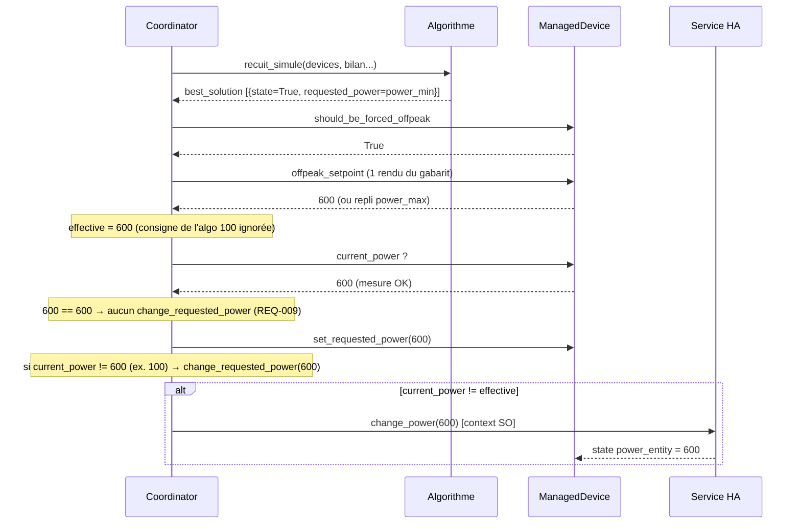

# Conception technique — Issue #231 : puissance invariante `offpeak_power` pendant le forçage heures creuses

## 1. Métadonnées

| Champ             | Valeur                                                                                                      |
| ----------------- | ----------------------------------------------------------------------------------------------------------- |
| Référence         | Issue [#231](https://github.com/jmcollin78/solar_optimizer/issues/231)                                      |
| Spécifications    | `documentation/tech-docs/issue-231-specifications.md` (REQ-001 → REQ-010, BR-001 → BR-005, AC-001 → AC-014) |
| Revue             | `documentation/tech-docs/issue-231-review.md`                                                               |
| Conception amont  | `documentation/tech-docs/issue-186-design.md` (§ 6.1 pseudocode de décision, à maintenir)                   |
| Date              | 2026-11-21                                                                                                  |
| Statut            | Brouillon — en attente d'approbation (aucune phase de développement autorisée)                              |
| Langue principale | Français (+ English Summary, § 12)                                                                          |
| Version locale    | manifeste 3.9.0 (commit non vérifié)                                                                        |

> **Règle imposée (décision utilisateur, 2026-11-21)** : tant que `should_be_forced_offpeak` est vrai `ET` `device.can_change_power` est vrai, la puissance appliquée **DOIT** être `offpeak_power`, **quelle que soit** la décision `state` de l'algorithme. Le forçage `state=True` ne doit plus permettre à la `requested_power` de l'algorithme (souvent `power_min`) de prévaloir.

---

## 2. Résumé du problème et de la solution

### 2.1 Problème constaté (fait vérifié, `coordinator.py` ~L275)

La consigne HC n'est sélectionnée que si **trois** conditions sont réunies :

```python
if should_force_offpeak and not state and device.can_change_power:
    effective_requested_power = device.offpeak_power
```

La condition `not state` signifie que, dès que la solution de l'algorithme est **active** (`state=True`), la `requested_power` de l'algorithme prévaut — y compris `power_min` (valeur initiale lors d'une activation simulée, `simulated_annealing_algo.py` ~L377). Le coordinateur peut alors émettre `change_requested_power(power_min)` pendant que le forçage HC est actif : c'est le chemin H1 de la revue, et la cause la plus probable des « passages à la puissance minimale » rapportés.

Cette priorité de l'algorithme correspond à la conception #186 originelle (pseudocode § 6.1 : `requested_power = algorithm_requested_power if algorithm_state else device.offpeak_power`). **La présente conception modifie cette décision** : la valeur de puissance relève désormais exclusivement de la consigne HC pendant le forçage, tandis que la décision on/off reste partagée (forçage + état de l'algorithme), conformément à BR-001/BR-004.

### 2.2 Solution retenue

Intervention **locale au point de sélection de la consigne** dans `coordinator.py` :

1. **Supprimer la conjonction `not state`** dans la sélection de la consigne HC : la consigne est imposée lorsque `should_force_offpeak AND device.can_change_power`, indépendamment de `state`.
2. **Factoriser la résolution de la valeur** (gabarit, repli `power_max`, validation, erreur) dans une **propriété unique** `offpeak_setpoint` de `ManagedDevice`, échantillonnée **une seule fois par cycle** par le coordinateur puis **réutilisée** pour `activate(...)` et `change_requested_power(...)` (reprend et étend la consigne de la conception #186 « sélectionnée une seule fois par cycle »).
3. **Ne toucher ni l'algorithme ni les règles on/off** : le forçage continue d'activer (`not is_active AND (state OR should_force_offpeak)`), les limites de durée continuent de passer par `should_be_forced_offpeak` / `check_usable(False)`, la temporisation `duration_power_min` continue de bloquer le forçage via `check_usable(False)`.
4. **Journaliser la décision de consigne** (appliquée / repli / non applicable + raison) au niveau `debug` (REQ-010).

Ce qui est **inchangé** : activation/désactivation, `set_requested_power`, override manuel, appareils `switch` (`can_change_power=False` ne rentre jamais dans la nouvelle branche), repli `power_max`, validation à l'initialisation.

### 2.3 Points de conception résolus (synthèse)

| #   | Point                               | Décision                                                                                             | Justification / réf. |
| --- | ----------------------------------- | ---------------------------------------------------------------------------------------------------- | -------------------- |
| 1   | Point d'intervention                | **Option A** : corriger la condition ~L275                                                           | § 3                  |
| 2   | Interaction avec l'algorithme       | Algorithme inchangé ; consigne écrasée **après** résolution de la solution                           | § 4                  |
| 3   | `duration_power_min`, `max_on_time` | Respectés par construction via `should_be_forced_offpeak` / `check_usable(False)` (Q-002 : Option A) | § 5                  |
| 4   | Gabarit dynamique                   | Échantillonné **1× par cycle**, valeur réutilisée sur tout le cycle (Q-003 : Option A)               | § 6                  |
| 5   | Entrée/sortie de la plage           | Aucune commande dédiée ; transition pilotée par la condition d'émission existante                    | § 7                  |
| 6   | Tests                               | Extensions de `tests/test_power_device.py`                                                           | § 9                  |
| 7   | Non-régression                      | `switch` et override manuel intouchés ; preuves par tests existants                                  | § 10                 |

---

## 3. Point d'intervention — Option A retenue

**Option A (retenue)** : modifier la condition de sélection ~L275 en supprimant `not state` :

```python
# avant
if should_force_offpeak and not state and device.can_change_power:
# après
if should_force_offpeak and device.can_change_power:
```

**Option B (rejetée)** : surécrire la consigne **après** la décision de l'algorithme, c.-à-d. dans les deux branches `activate`/`change power`, remplacer `effective_requested_power` par la consigne HC lorsque le forçage est actif.

Justification du choix :

- **Un seul point de sélection.** La condition ~L275 est le point unique où la valeur est choisie ; `effective_requested_power` est ensuite réutilisé par les deux chemins (`activate` à L~287 et `change_requested_power` à L~295). L'Option A garantit par construction la même valeur sur les deux chemins ; l'Option B duplique l'écriture de l'écrasement sur deux chemins et laisse deux chemins de repli/erreur à synchroniser.
- **Minimalité.** Une ligne de condition en moins, plus la factorisation de la résolution (§ 4.2). Aucun chemin de branchement on/off n'est modifié, donc la surface de régression est minimale.
- **Équivalence fonctionnelle.** L'Option B obtenait le même résultat final mais avec plus de code et un risque de divergence entre `activate` et `change_requested_power`.
- **Cohérence avec BR-001/BR-004.** La « priorité HC sur la valeur » s'exprime exactement à l'endroit où la valeur est décidée, pas après coup.

**Limite de l'Option A à documenter** : on ne vérifie que la **valeur envoyée** au service de changement de puissance. Toute commande **externe** tierce (H3 de la revue) reste hors du périmètre — la règle garantit la source Solar Optimizer uniquement.

---

## 4. Interaction avec l'algorithme

### 4.1 Que passe-t-on à l'algorithme quand le forçage est actif ?

**Rien de nouveau : l'algorithme n'est pas modifié.** Entrées inchangées (`is_usable`, `power_min`, `power_max`, `current_power` mesuré). L'algorithme reste libre de renvoyer `state=True` avec n'importe quelle `requested_power` (souvent `power_min` à l'activation simulée) : la consigne est **écrasée** au point de sélection du coordinateur **après** la résolution de la solution.

Conséquences acceptées (risques résiduels, § 11) :

- La solution calculée et la puissance effectivement appliquée **divergent** pendant le forçage actif : l'objectif et le bilan `total_power` de l'algorithme supposent `requested_power(algo)` alors que l'appareil consommera `offpeak_power`. Le coordonnateur écrit bien `set_requested_power(effective)` après application, donc le planning est corrigé au cycle suivant ; l'algorithme du cycle courant travaille sur l'état d'avant décision (comportement existant, latence d'un cycle).
- Le choix on/off de l'algorithme reste pertinent : un appareil forcible est `is_usable`, compte dans le bilan, et ses limites de durée bornent déjà le forçage.

**Alternative écartée (option 4 de la revue)** : exclure les appareils forcés de l'optimisation. Rejeté : PR #228 annulée par #229, difficulté de bilan de puissance documentée par #230 (hors périmètre), et l'exclusion priverait l'algorithme d'une décision on/off utile en fin de plage.

### 4.2 Factorisation : une seule résolution de la valeur par cycle

La propriété `offpeak_power` actuelle (gabarit, repli, validation) peut légitimement rendre des valeurs **différentes** à deux appels rapprochés si un gabarit change entre les deux rendus. On introduit donc :

| Fichier             | Changement                                                                                                                                                                                                                                                                                                                                                                                                                                                                                                                   |
| ------------------- | ---------------------------------------------------------------------------------------------------------------------------------------------------------------------------------------------------------------------------------------------------------------------------------------------------------------------------------------------------------------------------------------------------------------------------------------------------------------------------------------------------------------------------- |
| `managed_device.py` | **Nouvelle propriété** `offpeak_setpoint` : même corps que `offpeak_power` (gabarit → `float` → validation → repli `power_max` → `ConfigurationError`), sémantique « valeur de consigne HC résolue pour ce cycle ». La propriété `offpeak_power` est conservée mais devient un **alias** de `offpeak_setpoint` (non-régression des appels externes et tests existants).                                                                                                                                                      |
| `coordinator.py`    | Dans la boucle sur la solution : `offpeak_setpoint = device.offpeak_setpoint` (résolu **une fois**), dans la seule branche `should_force_offpeak and device.can_change_power` ; la même valeur est passée à `activate(...)` et `change_requested_power(...)`. En cas de `ConfigurationError`/`TypeError`/`ValueError` à la résolution : journalisation au niveau `error` avec nom d'appareil + clé invalide, puis `continue` (le cycle de cet appareil est sauté — comportement actuel conservé, AC-014 « non applicable »). |

```text
# coordinator.py — boucle sur best_solution (pseudocode de décision, à mettre à jour
# sur le pseudocode § 6.1 de issue-186-design.md)

offpeak_forced = should_force_offpeak and device.can_change_power
if offpeak_forced:
    try:
        effective_requested_power = device.offpeak_setpoint          # 1× par cycle
    except (ConfigurationError, TypeError, ValueError) as err:
        _LOGGER.error("%s - invalid off-peak power configuration: %s", device.name, err)
        continue
    _LOGGER.debug("%s - off-peak setpoint imposed (state=%s, algorithm power=%s ignored)",
                  device.name, state, requested_power)

# On/off : conditions inchangées (forçage OR algorithme)
if is_active and not state and not should_force_offpeak:
    deactivate()
elif not is_active and (state or should_force_offpeak):
    activate(effective_requested_power)        # consigne HC réutilisée

# Changement de puissance : condition d'émission adaptée (décision Q-004/Q-005 — Option A, validée 2026-11-21)
# Quand le forçage est actif, la comparaison se fait sur la dernière valeur planifiée
# (device.requested_power, mise à jour par set_requested_power) plutôt que sur la mesure,
# pour éviter la re-émission en cas de mesure indisponible (repli current_power → power_min).
# En hors forçage, le comportement existant (comparaison à la mesure) est conservé.
if should_force_offpeak and device.can_change_power:
    reference_value = device.requested_power   # dernière valeur demandée (plan)
else:
    reference_value = device.current_power     # mesure
if (state or should_force_offpeak) and device.can_change_power \
   and (reference_value != effective_requested_power or not is_active):
    change_requested_power(effective_requested_power)   # consigne HC réutilisée
```

**Différence unique avec le pseudocode #186** : la ligne `requested_power = algorithm_requested_power if algorithm_state else device.offpeak_power` devient `requested_power = effective_requested_power` (déjà égal à la valeur HC si forçage), c.-à-d. la suppression du `if algorithm_state else`.

### 4.3 Diagramme de séquence (cycle nominal, forçage actif, appareil actif)



---

## 5. Temporisation `duration_power_min` et limites `max_on_time`

Rappel des mécanismes vérifiés (`managed_device.py` ~L680, ~L428, ~L722) :

- `should_be_forced_offpeak` est **faux** si `check_usable(False)` est faux. Pour `can_change_power=True`, `check_usable(False)` inclut `now >= next_date_available_power` : la temporisation `duration_power_min` (réinitialisée à chaque `ACTION_ACTIVATE` et à chaque `ACTION_CHANGE_POWER` via `reset_next_date_available_power`) **bloque le forçage** jusqu'à son expiration.
- `should_be_forced_offpeak` est **faux** dès que `on_time_sec` atteint `max_on_time_per_day_sec`, `max_on_time_offpeak_sec` ou `min_on_time_per_day_sec` (déjà atteint).

**Décisions (BR-004 — priorités absolues des limites sur la consigne HC pour on/off) :**

| Limite / temporisation                                               | Effet sur le **forçage** (on/off)                                                                                                                                                                                                                                                                                                                                                                                                    | Effet sur la **valeur** pendant qu'il est actif                                                                        |
| -------------------------------------------------------------------- | ------------------------------------------------------------------------------------------------------------------------------------------------------------------------------------------------------------------------------------------------------------------------------------------------------------------------------------------------------------------------------------------------------------------------------------ | ---------------------------------------------------------------------------------------------------------------------- |
| `duration_power_min` en cours (Q-002, Option A retenue par la revue) | Le forçage est faux tant que la temporisation court : **aucune commande** n'est émise par ce chemin (pas de `change_power` HC « anticipé »). Si c'est l'algorithme qui active l'appareil pendant cette attente, c'est **sa** consigne qui s'applique ; au cycle suivant, forçage redevient vrai → bascule vers `offpeak_power`. Pas d'annulation de temporisation (option B rejetée : risque de violer la protection de l'appareil). | n/a (forçage inactif)                                                                                                  |
| `max_on_time_offpeak_min` atteinte                                   | Le forçage devient faux : l'appareil peut être désactivé par la règle `is_active AND not state AND not should_force_offpeak` ; aucune ré-activation forcée.                                                                                                                                                                                                                                                                          | La consigne HC n'est plus appliquée après l'arrêt (REQ-004)                                                            |
| `max_on_time_per_day_min` atteinte                                   | Idem (`check_usable(False)` faux → forçage faux, inutilisable).                                                                                                                                                                                                                                                                                                                                                                      | Idem                                                                                                                   |
| `min_on_time_per_day_min` atteint                                    | Le forçage devient faux **dans la plage** : **l'algorithme reprend la valeur** (risque de retour à `power_min`, c'est la conséquence directe de l'ancrage de la règle sur le forçage, pas sur la fenêtre horaire — Q-001 Option B, acceptée par la formulation de la règle de l'utilisateur « tant que should_force_offpeak est vrai »).                                                                                             | L'algo prévaut                                                                                                         |
| Appareil inactif                                                     | Le forçage peut être vrai ; l'appareil est alors **activé** avec la consigne HC (`activate(offpeak_setpoint)`) — comportement #186 conservé.                                                                                                                                                                                                                                                                                         | La consigne s'applique dès la 1ʳᵉ commande                                                                             |
| `is_waiting` (après changement d'état)                               | `check_usable(False)` ne teste PAS `next_date_available` (état), seulement la temporisation de puissance pour l'appareil variable : l'activation forçante peut donc se produire malgré `is_waiting` sur l'état — comportement existant conservé.                                                                                                                                                                                     | La temporisation de puissance, elle, bloque tout passage à la consigne HC tant qu'elle court (voir ligne 1 du tableau) |

**Conséquence à documenter pour l'utilisateur** : un appareil qui a déjà atteint `min_on_time_per_day_min` avant `offpeak_time` ne voit NI le forçage NI la consigne HC s'appliquer ; il est géré comme un appareil classique. C'est un comportement assumé de l'ancrage sur le forçage, à mentionner en note de version.

---

## 6. `offpeak_power` dynamique (gabarit) — décision Q-003 : Option A

**Décision : la valeur est échantillonnée une seule fois par cycle** (une résolution du gabarit par appareil par cycle), **pas une fois par plage**, et la valeur obtenue est **réutilisée** pour `activate` et `change_requested_power` dans ce même cycle.

Justification :

1. **« 1× par cycle » satisfait AC-005** : aucune variation non justifiée à l'intérieur d'un cycle (une seule résolution) ; la constance *de la valeur appliquée sur un cycle stable* (REQ-009) est préservée car en état stable (appareil actif, forçage actif, `current_power == consigne`), aucune émission n'a lieu, donc aucune re-résolution « nécessaire ».
2. **Option A stricte de la revue (figée sur toute la plage) est plus coûteuse** : elle impose un nouveau **état persistant par appareil** (consigne HC échantillonnée + horodatage d'entrée de plage + remise à zéro à `raz_time`), avec des pièges de restauration au redémarrage HA (contrat #186 : « aucun état HC supplémentaire ne doit être persisté »). Le gabarit est censé évoluer au rythme de son propre contexte (tarifs, production) ; la rejouer chaque cycle reste déterministe **dans** le cycle et cohérent avec le reste du système (tous les autres gabarits du plugin sont rendus au cycle).
3. **Sécurité de cycle** : si le gabarit résout une valeur invalide (hors `[power_min, power_max]`, non aligné sur `power_step`, non numérique) **au runtime** (l'initialisation n'avait pas pu valider un gabarit non résolu), `offpeak_setpoint` lève `ConfigurationError` : le cycle de cet appareil est **sauté** (pas de commande), la cause est journalisée au niveau `error` (§ 4.2). Pas de crash du coordonnateur, pas de commande invalide (AC-012 à l'init ; ici extension au runtime pour les gabarit).

**Comportement attendu testable (AC-005)** : sur un cycle donné, si le gabarit a rendu `600`, les services `activate` et `change_power` reçoivent `600` ; au cycle suivant, si le gabarit a rendu `800`, c'est `800` — la variation inter-cycles est attribuable au gabarit (traçable via le log de décision, § 6 de la spec / AC-014).

---

## 7. Transitions entrée / sortie de la plage

### 7.1 Entrée de la plage (`offpeak_time` atteinte)

- Appareil **inactif** : si le forçage est vrai, l'activation est forcée avec la consigne HC (`activate(offpeak_setpoint)`). Si `check_usable(False)` est faux (temporisation `duration_power_min` en cours), le forçage est faux : pas d'activation par ce chemin (voir § 5).
- Appareil **actif** : la consigne HC s'applique au 1ᵉʳ cycle où `should_force_offpeak` passe à vrai. Émission uniquement si `current_power != offpeak_setpoint` (ou si l'appareil vient d'être activé) : **pas de double commande** sur une activation forçante + changement (l'activation porte déjà la valeur correcte ; le `change` peut suivre dans le même cycle uniquement si la mesure/plan `current_power` diverge, cas `not is_active` — comportement inchangé du code actuel).
- Gabarit : première résolution de la plage = cycle d'entrée (rien n'est figé avant).

### 7.2 Sortie de la plage (`raz_time` atteinte)

- Le forçage devient faux (condition horaire de `should_be_forced_offpeak`). **Aucune commande dédiée** : le cycle suivant suit la solution de l'algorithme ; si l'algorithme demande une autre puissance que la valeur courante, la condition d'émission existante (`current_power != requested_power`) émet la transition — commande simple, non contradictoire (AC-009).

- Si l'algorithme décide `state=False` sur un appareil encore actif : désactivation classique ; pas d'émission de puissance vers un appareil arrêté (REQ-004).
- La remise à zéro existante du compteur `_on_time_sec` à `raz_time` n'est **pas** modifiée (hors périmètre, spec § 1.4).
- Fenêtre enroulante (`offpeak_time >= raz_time`) : l'horloge du forçage gère déjà le cas (BR-005) ; rien à ajouter.

### 7.3 Résumé des transitions de valeur

| Transition                        | Cycle t-1 (valeur appliquée) | Cycle t (décision)               | Commande émise                                           |
| --------------------------------- | ---------------------------- | -------------------------------- | -------------------------------------------------------- |
| Sortie d'offpeak, algo actif      | `offpeak` (600)              | forçage faux, algo `800`         | `change_power(800)` (600≠800)                            |
| Sortie d'offpeak, algo OFF        | `offpeak` (600)              | forçage faux, algo `state=False` | `deactivate()` (aucun change)                            |
| Entrée offpeak, appareil actif    | `100` (algo)                 | forçage vrai                     | `change_power(600)` (100≠600)                            |
| Entrée offpeak, forçage + inactif | `0`                          | activation forcée                | `activate(600)` + éventuel `change(600)` si mesure ≠ 600 |
| Stable en offpeak                 | `600`                        | forçage vrai, mesure 600         | **aucune** (REQ-009)                                     |

---

## 8. Modifications par fichier

| Fichier                                                                                                      | Modification                                                                                                                                                                                                                                                                                                                                                                                                                                                                                                                                                                                                                                                     | Impact                                                                                                                              |
| ------------------------------------------------------------------------------------------------------------ | ---------------------------------------------------------------------------------------------------------------------------------------------------------------------------------------------------------------------------------------------------------------------------------------------------------------------------------------------------------------------------------------------------------------------------------------------------------------------------------------------------------------------------------------------------------------------------------------------------------------------------------------------------------------- | ----------------------------------------------------------------------------------------------------------------------------------- |
| `custom_components/solar_optimizer/coordinator.py`                                                           | (a) Suppression de `not state` dans la condition de sélection de la consigne HC (~L275) ; (b) résolution de la valeur via `device.offpeak_setpoint` **une fois** par cycle, avant les branches on/off ; (c) journalisation `debug` de la décision « consigne HC imposée / repli / non applicable » avec raison ; (d) lorsque le forçage est actif, la condition d'émission `change_power` compare la cible à la dernière valeur **planifiée** (`device.requested_power`) plutôt qu'à la mesure (décision Q-004/Q-005, Option A) — le comportement existant (comparaison à la mesure) est conservé hors forçage ; (e) pas d'autre changement des branches on/off. | Comportement HC conforme à la règle ; le reste du cycle est intact ; pas de ré-émission en cas de mesure indisponible sous forçage. |
| `custom_components/solar_optimizer/managed_device.py`                                                        | Nouvelle propriété `offpeak_setpoint` (même corps que `offpeak_power` : gabarit, repli `power_max`, validation `ConfigurationError` au runtime pour les gabarit, `None`/rejet pour `can_change_power=False`). `offpeak_power` conservé en **alias** de `offpeak_setpoint` (non-régression des appels externes et tests existants).                                                                                                                                                                                                                                                                                                                               | Une seule source de vérité pour la valeur ; le gabarit est résolu 1× par cycle depuis le coordinateur.                              |
| `custom_components/solar_optimizer/simulated_annealing_algo.py`                                              | **Aucune modification.**                                                                                                                                                                                                                                                                                                                                                                                                                                                                                                                                                                                                                                         | Le bilan diverge de la valeur réellement appliquée pendant le forçage (risque résiduel R1, § 11).                                   |
| `custom_components/solar_optimizer/sensor.py`, `switch.py`, `const.py`, `config_schema.py`, `config_flow.py` | Aucune modification.                                                                                                                                                                                                                                                                                                                                                                                                                                                                                                                                                                                                                                             | Pas de nouvelle entité, pas de nouveau champ, pas de migration.                                                                     |
| `tests/test_power_device.py`                                                                                 | Extensions (§ 9).                                                                                                                                                                                                                                                                                                                                                                                                                                                                                                                                                                                                                                                | Couverture des AC-001 → AC-009, AC-011 → AC-014.                                                                                    |
| `README-fr.md` / `README.md`                                                                                 | Note de version : « pendant le forçage heures creuses, la consigne HC est imposée quel que soit l'état demandé par l'algorithme ; la priorité du forçage sur la valeur, précédemment documentée (issue #186 : priorité à l'algorithme quand sa solution est active), est remplacée. »                                                                                                                                                                                                                                                                                                                                                                            | Communication du changement de contrat (spec § 5).                                                                                  |

### 8.1 Points de vigilance de l'implémentation

- **Ne pas déplacer** la résolution hors de la boucle par appareil : chaque appareil a son propre gabarit / repli.
- **Conserver** `set_requested_power(effective)` en fin de boucle sur la **valeur effectivement appliquée** (la consigne HC en cas de forçage), afin que le planning du cycle suivant seede correctement `requested_power` de la solution initiale de l'algorithme (`simulated_annealing_algo.py` ~L138 : `"requested_power": device.current_power`).
- **Conserver** la séquence `continue` (saute du cycle cet appareil) si la résolution lève une exception : ne jamais laisser `effective_requested_power` indéfini pour la suite de la boucle.
- **Ne pas** introduire de persistance d'état (contrat #186 : « aucun état HC supplémentaire ne doit être persisté ») : la décision est entièrement dérivée de l'heure, des compteurs et du gabarit au moment du cycle.
- **Journalisation** au niveau `debug` par décision : « consigne HC imposée » (valeur + raison : forçage actif), « repli `power_max` » (aucune `offpeak_power` configurée), « non applicable » (appareil inactif, temporaire, limite). Aucune donnée sensible (REQ-010).

---

## 9. Stratégie de tests (`tests/test_power_device.py`)

Conventions (reprises du test existant) : `patch.object(coordinator._algo, "recuit_simule", ...)` pour forcer la solution ; `patch.object(type(device), "should_be_forced_offpeak"/"is_active", PropertyMock)` pour les décisions ; `patch.object(device, "activate"/"change_requested_power", AsyncMock)` pour observer les **actions réellement demandées** ; `device._set_now(...)` pour les heures.

### 9.1 Matrice des scénarios

| Réf. | Scénario (préconditions)                                                                                                                                                                                                                                                                                                | Entrées simulées                                                                                                                            | Sortie attendue (actions)                                                                                                                                                                                         | AC                              |
| ---- | ----------------------------------------------------------------------------------------------------------------------------------------------------------------------------------------------------------------------------------------------------------------------------------------------------------------------- | ------------------------------------------------------------------------------------------------------------------------------------------- | ----------------------------------------------------------------------------------------------------------------------------------------------------------------------------------------------------------------- | ------------------------------- |
| T1   | Forçage ON, **solution active `power_min`**, appareil actif, `offpeak_power=600`                                                                                                                                                                                                                                        | `solution=[{state:True, requested_power:100}]`, `current_power=600`                                                                         | `activate`/`change` **non appelés** (déjà à 600) ; `set_requested_power(600)` ; log « consigne HC imposée (algo 100 ignoré) »                                                                                     | AC-001, AC-002                  |
| T2   | Idem T1 mais `current_power=100` (mesure à la valeur de l'algo)                                                                                                                                                                                                                                                         | `current_power=100`                                                                                                                         | `change_requested_power(600)` **une** fois ; jamais `100` émise                                                                                                                                                   | AC-002                          |
| T3   | Multi-cycles alternés (3 cycles : algo ON/`power_min`, algo OFF, algo ON/`power_min`), forçage ON stable, `offpeak_power=600`                                                                                                                                                                                           | 3 × `_async_update_data()`                                                                                                                  | Sur chaque cycle : émission ≤ 1 ; valeur toujours 600 ; aucune émission vers 100                                                                                                                                  | AC-001                          |
| T4   | Forçage ON, solution active, **device inactif**                                                                                                                                                                                                                                                                         | `is_active=False`, `solution state=True`                                                                                                    | `activate(600)` ; `change_power` appelé seulement si condition `current_power != 600 or not is_active` (ici `not is_active` → appelé, valeur 600)                                                                 | AC-001                          |
| T5   | `offpeak_power` absent → repli `1000` (`power_max`)                                                                                                                                                                                                                                                                     | `offpeak_power=None`                                                                                                                        | `activate(1000)` puis `change(1000)` (test paramétré existant conservé) ; constant sur 3 cycles                                                                                                                   | AC-003                          |
| T6   | Gabarit `{{ 600 }}` stable + **gabarit variable** : `input_number.offpeak_power` passe de 600→800 entre deux cycles                                                                                                                                                                                                     | 2 cycles, valeur HA changée entre                                                                                                           | Cycle 1 : 600 ; cycle 2 : **800** (re-échantillonnage 1×/cycle) ; aucune valeur `None`/intermédiaire                                                                                                              | AC-005                          |
| T7   | Forçage ON, appareil **inactif**, algo `state=False`                                                                                                                                                                                                                                                                    | `is_active=False`, `solution state=False`                                                                                                   | `activate(600)` (le forçage force l'activation — comportement #186 conservé)                                                                                                                                      | —                               |
| T8   | `duration_power_min=2` encore en cours à l'entrée de la plage                                                                                                                                                                                                                                                           | `next_date_available_power` dans le futur → `should_be_forced_offpeak=PropertyMock(False)` (effet de la temporisation), algo ON/`power_min` | Cycle t : `activate(100)` (consigne **algo**, pas HC) ; cycle t+1 (forçage redevient vrai) : `change(600)`                                                                                                        | AC-008                          |
| T9   | `max_on_time_offpeak_min=10` atteinte                                                                                                                                                                                                                                                                                   | `on_time_sec = 600` (compteur réel, pas de mock)                                                                                            | `should_be_forced_offpeak` faux (valeur réelle du compteur) ; si algo OFF : `deactivate()` ; si algo ON : consigne **algo**                                                                                       | AC-007                          |
| T10  | Fenêtre enroulante `offpeak_time=23:00`, `raz_time=05:00`                                                                                                                                                                                                                                                               | `now=00:38`                                                                                                                                 | Forçage vrai, consigne HC                                                                                                                                                                                         | AC-001 (variante)               |
| T11  | Forçage ON mais `enable=False` (override manuel, `respect_manual_changes=True` après changement d'état)                                                                                                                                                                                                                 | override actif                                                                                                                              | `should_be_forced_offpeak` faux ; **aucune** émission SO                                                                                                                                                          | AC-011                          |
| T12  | Gabarit résolvant `invalid` au runtime (test existant conservé + extension : gabarit valide→invalide entre 2 cycles)                                                                                                                                                                                                    | template → « invalid »                                                                                                                      | `activate`/`change` non appelés, `best_solution` inchangée, erreur `error` journalisée                                                                                                                            | AC-012, AC-014                  |
| T13  | Multi-appareils : device A forcible + variable, device B switch forcible, device C variable non-forgé                                                                                                                                                                                                                   | forçage A vrai, B vrai, C faux                                                                                                              | A : consigne HC ; B : activation **sans** `change` ; C : consigne algo                                                                                                                                            | REQ-007 (non-régression switch) |
| T14  | **Mesure indisponible sous forçage actif** (décision Q-004/Q-005) : appareil actif à `offpeak_power`, forçage vrai ; le premier cycle émet `change_power(600)` si plan ≠ 600 ; au cycle suivant, la mesure est indisponible → `current_power` re-tombe sur `power_min` (100), mais la dernière valeur planifiée est 600 | 2 cycles ; `set_current_power_with_device_state` simulé avec mesure indisponible au cycle 2                                                 | Cycle 1 : `change_power(600)` si nécessaire ; cycle 2 : **aucun** `change_power` (comparaison sur le plan : 600 == 600) — AC-013, REQ-009 ; le comportement hors forçage (comparaison à la mesure) reste inchangé | AC-013, REQ-009                 |

### 9.2 Scénarios de non-régression (existants à conserver)

| Réf. | Test existant                                                                                                         | Pourquoi conservé                                |
| ---- | --------------------------------------------------------------------------------------------------------------------- | ------------------------------------------------ |
| N1   | `test_offpeak_forcing_sets_variable_device_power` (paramétré : 600 / `{{ 600 }}` / repli 1000, solution **inactive**) | Comportement #186 inchangé sur solution inactive |
| N2   | `test_offpeak_power_is_rejected_for_standard_device`                                                                  | Validation initiale `switch` + `offpeak_power`   |
| N3   | `test_invalid_offpeak_power_template_does_not_interrupt_cycle`                                                        | Saute de cycle appareil sur gabarit invalide     |
| N4   | `test_power_device` (batterie de propriétés du constructeur)                                                          | Non-régression constructeur                      |

### 9.3 Assertions spécifiques à ajouter

- `activate.assert_awaited_once_with(offpeak)` et `change_power.assert_awaited_once_with(offpeak)` avec la **même** valeur (1×/cycle) ;
- `change_power.assert_not_awaited()` en état stable (T1, REQ-009) ;
- vérification du **journal** (`caplog` sur le logger du coordonnateur) : présence de l'entrée de décision avec nom d'appareil, valeur cible et raison (AC-014) ;
- `calculated_data["best_solution"]` reste la solution **d'origine** de l'algorithme (l'écrasement ne modifie pas la solution stockée, seulement la valeur appliquée).

---

## 10. Non-régression : `switch` et override manuel

| Cas                                                                          | Pourquoi c'est sûr (preuve par lecture du code)                                                                                                                                                                                                                                                                                                                                                                                   | Test                                                         |
| ---------------------------------------------------------------------------- | --------------------------------------------------------------------------------------------------------------------------------------------------------------------------------------------------------------------------------------------------------------------------------------------------------------------------------------------------------------------------------------------------------------------------------- | ------------------------------------------------------------ |
| Appareil `switch` (`can_change_power=False`)                                 | La nouvelle condition `should_force_offpeak and device.can_change_power` **ne rentre jamais** dans la branche de valeur : aucun effet possible sur la valeur (il n'y a pas de variation de puissance pour un switch). Les branches on/off sont inchangées ; le forçage active toujours (contrat #186 pour appareils standard). Validation initiale : `offpeak_power` + `can_change_power=False` levait déjà `ConfigurationError`. | N2, T13, `test_min_on_time.py`, `test_nominal.py`            |
| Override manuel (`respect_manual_changes=True`, ou `enable=False` explicite) | `check_for_manual_override()` → `trigger_manual_override()` → `set_enable(False)` ; avec `_enable=False` le forçage HC est faux (le verrou `enable` est lu par le coordinateur avant la boucle sur `best_solution`) et **aucune** commande n'est émise. La consigne HC ne peut donc pas écraser une surcharge manuelle (Q-006 → Option par défaut : la surcharge garde la priorité selon son contrat existant).                   | T11, `test_manual_override.py`, `test_override_scenarios.py` |
| `forced_end_time` (activation forcée utilisateur)                            | `start_forced()` met `enable=False` : même verrou d'override, aucune émission par le coordinateur.                                                                                                                                                                                                                                                                                                                                | `test_manual_override.py`                                    |
| Redémarrage HA                                                               | Aucun état HC persistant (§ 6, contrat #186) : la décision est reconstruite depuis l'heure + compteurs + gabarit au 1ᵉʳ cycle ; les restaurations existantes (`set_on_time`, `set_override_state`, `set_forced_end_time`) sont non modifiées.                                                                                                                                                                                     | `test_restore_and_power_fixes.py`                            |

> **Point à surveiller (R5)** : vérifier à l'implémentation que le coordinateur ne traite pas un appareil `enable=False` / override actif dans sa boucle sur `best_solution` ; si ce n'est pas déjà le cas, T11 couvrira ce path. Si le forçage HC peut émettre alors que l'override est actif, c'est un bogue à corriger en amont des tests.

---

## 11. Risques résiduels

| Réf. | Risque                                                                                                                                                                                                                                                                                                                                                                                | Gravité / probabilité                | Mesure                                                                                                                                                                                                                                                                                                                                                                                                                                                                                |
| ---- | ------------------------------------------------------------------------------------------------------------------------------------------------------------------------------------------------------------------------------------------------------------------------------------------------------------------------------------------------------------------------------------- | ------------------------------------ | ------------------------------------------------------------------------------------------------------------------------------------------------------------------------------------------------------------------------------------------------------------------------------------------------------------------------------------------------------------------------------------------------------------------------------------------------------------------------------------- |
| R1   | **Divergence solution appliquée vs bilan** : l'algorithme calcule `total_power` et l'objectif avec `requested_power(algo)` alors que l'appareil forcible consomme réellement `offpeak_power` ; le planning est corrigé au cycle suivant (`set_requested_power(effective)`), latence 1 cycle.                                                                                          | Moyenne / possible                   | Documenter ; option future (hors périmètre) : passer la valeur forcée **au** l'algorithme pour ses bilans                                                                                                                                                                                                                                                                                                                                                                             |
| R2   | **Re-émission en cas de mesure indisponible** : `current_power` re-tombant sur `power_min` (repli `set_current_power_with_device_state`) alors que l'appareil est réellement à `offpeak_power` → condition `current_power != effective` vraie → `change_power(600)` ré-émis à chaque cycle. Ne viole pas AC-013 stricto (mesure ≠ cible) mais va à l'encontre de l'esprit de REQ-009. | Moyenne / conditionnelle à la mesure | **Décision validée par l'utilisateur (2026-11-21) — Option A** : comparer au **planning** (`device.requested_power`) plutôt qu'à la mesure quand le forçage est actif et la mesure indisponible. Implémentation : dans la condition d'émission, si le forçage est actif, remplacer la comparaison `device.current_power != effective_requested_power` par une comparaison avec la dernière valeur planifiée ; la ré-émission ne survient alors qu'en cas de divergence réelle du plan |
| R3   | **Forçage qui s'éteint dans la plage** (`min_on_time_per_day_min` atteint) : la valeur peut repasser à `power_min` alors que la fenêtre HC est toujours ouverte.                                                                                                                                                                                                                      | Faible / probable par conception     | Accepté ; journalisation `error` (AC-014) ; option future : maintenir la dernière valeur valide                                                                                                                                                                                                                                                                                                                                                                                       |
| R4   | Gabarit de `offpeak_power` qui bascule de valeur valide à valeur invalide **au runtime** : le cycle de l'appareil est sauté et la valeur **précédente** n'est pas réémise (l'appareil continue sa trajectoire actuelle, potentiellement à `power_min`).                                                                                                                               | Faible / faible                      | Accepté ; journalisation `error` (AC-014) ; option future : maintenir la dernière valeur valide                                                                                                                                                                                                                                                                                                                                                                                       |
| R5   | L'override manuel / `enable=False` ne passe peut-être **pas** par un verrou lu par `should_be_forced_offpeak` sur tous les chemins (ex. `respect_manual_changes=False`) : le comportement doit rester « SO reprend, consigne HC applicable » sur le cas `respect_manual_changes=False`, et « pas d'émission » sur le cas `respect_manual_changes=True` ; à vérifier par test.         | Faible / peu probable                | T11 couvre le cas `respect_manual_changes=True` ; ajouter un test dédié au cas `respect_manual_changes=False` pour figer le contrat                                                                                                                                                                                                                                                                                                                                                   |
| R6   | **Risque incident réel non résolu** : la présente conception corrige le chemin H1 (priorité de l'optimiseur) mais ne prouve pas que l'incident #231 est H1 (causes H2/H3 non exclues).                                                                                                                                                                                                | n/a                                  | Constat factuel : les tests T1–T3 constituent une reproduction **synthétique** du chemin suspect ; la corrélation journaux réelle en attente (revue, « informations à obtenir »)                                                                                                                                                                                                                                                                                                      |
| R7   | `effective_requested_power` indéfini si le `continue` d'exception ne couvre pas un échec tardif (ex. échec dans `activate`).                                                                                                                                                                                                                                                          | Faible / faible                      | Le `continue` précède toutes les émissions ; l'émission `activate` échouant ne laisse pas la variable en état indéfini pour le `change`                                                                                                                                                                                                                                                                                                                                               |

---

## 12. English Summary

**Issue #231 — constant `offpeak_power` during off-peak forcing.** During an off-peak window a variable-power device was observed dropping to `power_min` repeatedly. Root path confirmed in local code: `coordinator.py` (~L275) selects the off-peak setpoint **only** when `should_force_offpeak AND not algorithm_state AND can_change_power`; as soon as the algorithm's solution is active, its `requested_power` (often `power_min` after a simulated activation) is applied instead, even while off-peak forcing remains active.

**Decision (user, 2026-11-21):** while `should_be_forced_offpeak` is true **and** `device.can_change_power`, the applied power MUST be `offpeak_power`, regardless of the algorithm's `state` decision.

**Design summary:**
1. **Intervention — Option A chosen:** drop `not state` from the selection condition (~L275). The single selection point (already reused by both the `activate` and `change_power` paths) is corrected with a one-line change. Option B (override after the algorithm's decision) rejected: duplicates the fallback/error logic across two paths.
2. **Algorithm unchanged:** it keeps running with its inputs and may return any `requested_power`; the setpoint is overridden at the coordinator's selection point. Accepted side-effect: the algorithm's balance/objective diverges from the actually applied power during forcing (corrected next cycle via `set_requested_power(effective)`).
3. **One resolution per cycle:** a new `offpeak_setpoint` property on `ManagedDevice` (same body as `offpeak_power`: template, `power_max` fallback, runtime `ConfigurationError` for unresolved templates) sampled **once per cycle** and reused for `activate` and `change_requested_power`. Open question Q-003 resolved as 1× per cycle (not frozen for the whole window) — no new persisted state (contract #186). Runtime-invalid template value → that device's cycle is skipped, `error` logged.
4. **Limits & timeouts (Q-002: respect option):** `duration_power_min` blocks forcing via `check_usable(False)` (no HC command while the timer runs); `max_on_time_offpeak_min` / `max_on_time_per_day_min` / `min_on_time_per_day_min` stop forcing via the existing counters, after which the algorithm regains the value (documented; the rule is anchored on the forcing decision, not the raw window).
5. **Transitions:** no dedicated command at entry/exit of the window; the existing emission condition (`current_power != requested` or just-activated) drives a single, non-contradictory transition (AC-009). Stable state: no re-issuance (REQ-009). **Q-004/Q-005 decision (user-validated, 2026-11-21, Option A):** while off-peak forcing is active, the emission condition compares the target against the last **planned** value (`device.requested_power`) instead of the measurement, preventing re-issuance loops when the power measurement is unavailable (fallback to `power_min`); non-forcing behaviour unchanged.
6. **Tests:** matrix T1–T14 in `tests/test_power_device.py` (discriminant: forcing ON + active solution at `power_min` → `offpeak_power` applied, never `power_min`; multi-cycle; absent fallback; dynamic template 1×/cycle; power-change timeout; wrap-around window; manual override; invalid runtime template; multi-device; unavailable measurement under forcing → no re-issuance, planning comparison), plus existing tests N1–N4 kept unchanged.
7. **Non-regression:** `switch`-typed devices never enter the new branch (`can_change_power=False`); manual override and forced activation keep working through the same `enable` lock (verified in test; R5 flagged for a dedicated `respect_manual_changes=False` test).

**Residual risks:** R1 algorithm-vs-applied divergence; R2 re-issuance with unavailable measurement — **mitigated by the Option A planning-comparison decision (user-validated)**; R3 forcing ceasing mid-window (documented, accepted); R4 runtime template becoming invalid (cycle skipped); R5 override-lock coverage to be proven by tests; R6 real incident's root cause still unconfirmed — T1–T3 are a synthetic reproduction of path H1 only.

**Status:** draft, awaiting approval; no development phase is authorised.
